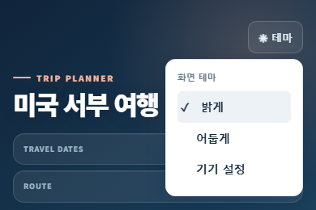

# 기존 버전 UI 수정 계획

확정일: 2026-10-24 (Asia/Seoul)

**상태: 별도 구현 브랜치에서 구현·자동 검증 완료, 공개 배포 전. 화면 테마는 B안(테마 버튼 + 펼침 메뉴)으로 확정했다.** Daylight 추가 개발과 운영 전환은 보류하고 기존 앱을 개선한다. 2026-10-24 후속 요청에 따라 아래 순서로 기존 앱 구현과 자동 검증을 완료했다. 실제 모바일 기기 확인은 구현 기록의 미확인 항목으로 남긴다. 실제 결과·검증 범위는 [구현 기록](archive/2026-10-24-legacy-ui-refinement.md)을 따른다. 공유 여행 데이터와 공개 사이트는 로컬 구현 작업으로 변경하지 않는다.

## 1. 기준과 범위

- 기존 앱의 네이비 헤더, 코럴 강조색, 카드 형태와 글꼴을 유지한다. 모바일 여행 조회와 PC 계획·지출 편집 모두를 지원한다.
- 실제 구현은 최신 배포 브랜치의 기존 앱을 기준으로 시작한다. 계획 검토 시 로컬 `origin/main`은 `1ff42eb3205d8f499042df462e2026f8798296f8`이었다. 이는 로컬 참조의 관측값이며 구현 시 최신 상태를 다시 확인한다.
- 현재 계획을 기록하는 `codex/daylight-implementation`의 루트 `index.html`은 Daylight 후보다. 이 파일을 기존 앱이라고 보고 수정하거나 브랜치 전체를 배포 브랜치에 합치지 않는다. 후속 구현은 최신 배포 기준에서 별도 `codex/` 브랜치로 진행하고 이 계획 문서를 가져온다.
- Daylight 코드·공개 경로·과거 검토 기록은 보존한다. 보류는 삭제나 사이트 폐쇄를 뜻하지 않는다. 두 앱이 공유하는 저장 데이터와 기존 메타데이터 호환 처리도 유지한다.
- 새 프레임워크·서버·DB 변경 없이 기존 HTML·CSS·JavaScript 패턴을 활용한다.

## 2. 확정한 화면과 동작

### 2.1 하단의 일정·준비·가계부

- 모바일·PC 모두 하단에 `일정 · 준비 · 가계부` 세 메뉴를 고정한다. 아이콘과 한글 이름을 함께 표시하고 선택 상태를 구분한다. 넓은 화면에서는 기존 본문 폭에 맞춰 메뉴를 배치한다.
- 기존 상단의 PREP·가계부 항목은 제거한다. 날짜 선택과 `일별 일정 / 시간표` 전환은 일정 화면에만 표시한다. 기존 헤더와 편집·저장 기능은 유지한다.
- 최초 진입은 기존 `selectInitialTab()`의 판정을 유지한다. 여행 첫날 전에는 준비, 여행 첫날부터 마지막 날까지는 접속 기기 날짜의 일정, 마지막 날 이후에는 가계부를 연다. 목적지 시간대로 새로 고정하거나 마지막 방문 탭을 최초 화면보다 우선하지 않는다.
- 일정 탭으로 돌아오면 해당 실행에서 마지막으로 선택한 날짜·보기 방식을 유지한다. 아직 일정 화면을 선택하지 않았다면 여행 중에는 기존 날짜 판정 결과, 여행 전·후에는 첫날을 사용한다.
- 사용자 선택 이후 시계·공유본 갱신이 탭과 날짜를 임의로 바꾸지 않는다. 탭 이동으로 가계부 입력 중 내용이나 미저장 초안이 유실되지 않게 한다.
- 메뉴 높이와 기기 안전 영역만큼 본문 아래 여백을 확보한다. 마지막 항목·순서 이동 버튼·오류 안내가 가려지지 않아야 한다. 입력 키보드, 확대 화면, 대화상자와 겹침도 확인한다.

### 2.2 예산 표시와 입력 제거

- 가계부의 예산 진행률, 예산 금액, 잔액·초과 표시와 가계부 설정의 예산 입력을 제거한다.
- 실제 KRW·USD 합계, 원화 환산 합계, 수동 환율, 카테고리별 합계와 카테고리 관리는 유지한다.
- 기존 저장본·초안·버전·작업본의 `budgetKrw`와 설정의 `defaultBudgetKrw`는 호환 필드로 보존한다. 화면에서는 사용하거나 수정하지 않는다. 필드 삭제를 위한 스키마 변경·DB 마이그레이션은 하지 않는다.
- 과거 저장 HTML을 불러와도 제거한 예산 UI가 다시 나타나지 않도록 현재 화면으로 정규화한다. 데이터 보존과 UI 제거를 각각 확인한다.

### 2.3 지출 필터 제거와 CSV

- 검색, 카테고리, 시작일·종료일 필터, 필터 초기화 버튼, 필터 결과 안내를 제거한다. 지출 입력·수정에 쓰는 날짜와 카테고리는 유지한다.
- `CSV 내보내기` 버튼을 `지출 내역` 제목 오른쪽에 배치한다. 별도의 필터 영역을 남기지 않는다.
- 항상 현재 가계부의 전체 내역을 화면의 사용자 지정 순서대로 내보낸다. 저장 전 변경 내용도 현재 내역에 포함하는 기존 동작을 유지한다.
- 날짜·내용·카테고리·통화·금액·원화 환산액 열, UTF-8 BOM, 특수문자 처리, 수식 주입 방지와 기존 반올림 규칙을 유지한다. 빈 목록은 헤더만 있는 CSV로 내보낸다.
- 필터 변수·이벤트·렌더링 의존성을 함께 정리한다. UI만 숨겨 내역이나 CSV에 보이지 않는 필터가 적용되는 상태를 남기지 않는다.

### 2.4 경비 추가 버튼

- 사이트 본문 글꼴을 상속하고 크기·굵기·행간을 다른 주요 버튼과 맞춘다. 아이콘은 기존 아이콘 체계를 사용한다.
- `＋ 경비 추가`를 한 줄로 가운데 정렬한다. 모바일에서는 입력란 아래 가로폭을 채우고, PC에서는 입력 영역에 충분한 버튼 폭을 확보해 글자가 잘리거나 세로로 꺾이지 않게 한다.
- 최소 44px 누름 영역을 확보하고 입력 오류·권한·저장 동작은 유지한다.

### 2.5 등록순 문구 제거

- 지출 내역 제목 옆과 목록 요약의 `등록순`을 모두 제거한다. 대체 정렬 설명은 추가하지 않는다.
- 기존 위·아래 이동과 배열 순서 저장·복원은 유지한다. 필터 상태에 따른 이동 제한은 제거하고 첫 항목의 위로·마지막 항목의 아래로 이동 제한은 유지한다.

### 2.6 화면 테마 — B안 확정

- 헤더 오른쪽 위의 큰 선택창을 작은 `테마` 버튼으로 바꾼다. 기존 헤더에 어울리는 반투명 바탕과 얇은 테두리를 사용한다. 새 설정 메뉴 전체를 만드는 범위는 아니다.
- 버튼을 누르면 바로 아래에 `화면 테마` 제목과 `밝게 · 어둡게 · 기기 설정` 세 선택지를 표시한다. 현재 선택에는 체크 표시를 붙인다. 버튼 아이콘은 현재 적용된 밝기와 맞춘다.
- 선택 즉시 반영하고 메뉴를 닫는다. 버튼 재클릭, 메뉴 밖 클릭, Esc로도 닫히며, 키보드로 선택·닫기한 뒤에는 테마 버튼으로 포커스를 돌린다. 포커스가 메뉴 밖으로 이동하면 메뉴를 닫되 포커스를 빼앗지 않는다.
- 버튼의 펼침 상태와 선택지의 단일 선택 상태를 보조 기술에 전달한다. 기존 아이콘·기본 라디오 컨트롤 등 단순한 구현을 우선하고 불필요한 메뉴 라이브러리는 추가하지 않는다.
- 작은 화면에서도 메뉴가 좌우로 잘리지 않아야 한다. 대화상자보다 앞에 뜨거나 하단 메뉴에 가려지지 않도록 겹침 순서를 정한다.
- 기존의 테마 기본값, 경로별 localStorage 저장, 기기 설정 실시간 반영, 저장 실패 안내를 유지한다. 저장 실패 안내는 메뉴를 닫아도 확인할 수 있게 한다.
- 테마 선택은 여행 데이터·초안·버전 이력과 분리한다. 오프라인 작업본에서는 사용 가능하고 인쇄·공유용 사본에서는 제거되는 기존 정책을 유지한다.

## 3. 승인한 시각 참고

이미지는 2026-10-24 대화에서 제시한 기존 버전 기반 배치 초안이다. `ui-preview/daylight-before.html`의 격리된 예시 데이터를 브라우저에서 사용했으며 실제 여행 데이터·공개 앱을 수정하지 않았다. 제품 구현 결과나 검증 통과 증거가 아니다.

- [A/B 비교 이미지](ui-concepts/previews/legacy-refinement-2026-10-24/theme-options.png): 오른쪽 B안을 선택했다.
- [가계부 본문·하단 메뉴 초안](ui-concepts/previews/legacy-refinement-2026-10-24/ledger-draft.png): 헤더를 생략하고 본문을 보여주는 긴 캡처다. 앱에서 헤더를 제거한다는 뜻이 아니다. 오프라인 표식·날짜·금액은 예시다.
- 초안의 비례·배치를 참고하되 최종 글꼴·아이콘은 기존 앱을 따른다. 실제 모바일 화면에서는 본문을 스크롤하고 하단 메뉴는 고정된다.

## 4. 구현 순서와 완료 기준

1. 최신 기존 앱과 저장·복원·내보내기 경로를 확인하고 별도 구현 브랜치를 준비한다. 이 계획 커밋은 문서만 포함한다.
2. 하단 탐색을 연결하고 최초 화면·날짜·일별 일정·시간표·편집 상태를 확인한다. 원본 일정 DOM을 복제하지 않고 현재 상태 수집·적용 경로를 유지한다.
3. 예산·필터·등록순 UI와 관련 연결을 정리하고 CSV 및 경비 추가 버튼을 수정한다. 현재 화면과 과거 저장 HTML 적용 후의 화면을 모두 확인한다.
4. B안 테마 메뉴를 구현하고 밝게·어둡게·기기 설정, 키보드·포커스·저장 실패를 확인한다.
5. 관련 단위·브라우저 검사를 갱신해 실행하고 아래 회귀 기준을 충족한다. 테스트 범위와 실행법의 기준은 [운영 안내서](OPERATIONS_KO.md#validation)를 따른다.
6. 실제 구현에 맞춰 [사용자 안내서](USER_GUIDE_KO.md)의 탐색·가계부·테마, [기술 설명서](PROJECT_GUIDE_KO.md)의 상태·호환 처리, [운영 안내서](OPERATIONS_KO.md)의 검증·배포 절차를 갱신한다. 현재 계획 단계에서는 기존 사용법을 구현된 것처럼 바꾸지 않는다.

| 확인 영역 | 완료 기준 |
|---|---|
| 첫 화면 | 여행 전·첫날·중간 날짜·마지막 날·여행 후, 서울/미국 서부 기기 시간대의 날짜 경계에서 기존 판정 유지 |
| 탐색 | 세 탭 왕복, 일정 날짜·보기 유지, 서버 갱신 후 선택 유지, 입력 중 내용·초안 보존 |
| 가계부 | 예산·필터·등록순 없음, 추가·수정·삭제·위아래 이동·저장·재열기 정상 |
| CSV | 전체 내역과 사용자 순서 일치, 빈 목록·한글·쉼표·따옴표·줄바꿈·수식 형태 문자열 처리, 통화·반올림 유지 |
| 호환성 | 이전 공유본·초안·버전 복원·오프라인 작업본 적용 뒤 예산 UI 재등장 없음, 기존 예산 값·중요 표시·숙박 기간·지출 순서 보존 |
| 화면 | 320·390·768·1440px와 실제 분기점 전후에서 버튼 줄바꿈·가로 넘침·하단 가림 없음, 두 테마·확대·모바일 키보드 확인 |
| 테마 | 선택 표시·저장·재열기·기기 설정 변경·저장 차단, 메뉴 열기·밖 클릭·Esc·키보드·포커스 복귀 정상 |
| 내보내기 | 편집 가능한 작업본의 새 탐색·테마 유지, 인쇄·공유용 사본에서 조작 메뉴 제거와 밝은 인쇄 유지 |

검증 결과는 실제 실행일의 `docs/archive/` 기록으로 남긴다. 위 표는 확정한 합격 기준이며 실제 실행 결과와 미확인 항목은 구현 기록에서 구분한다. 본 계획과 이미지가 들어가는 `docs/`는 기존 `_config.yml`의 Pages 제외 범위에 포함된다.
