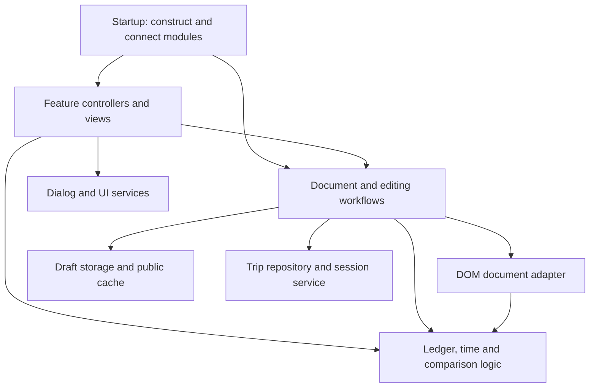

# Modularization review and implementation plan

Review date: October 26, 2026. Baseline: `de00d47` on `codex/modularize-travel-app`.
Status: stages 0–6 implemented, including Stop A/B reviews. See the [staged implementation and verification record](archive/2026-10-26-modularization-implementation.md); final delivery checks are recorded there. CSS layers/order/values were retained after Stop B.

The review below preserves the original rationale and acceptance gates. Reviewed source links point to the baseline snapshot; [PROJECT_GUIDE.md](PROJECT_GUIDE.md#source-modules) owns the current module map.

## 1. Recommendation

Keep the static application, deterministic source assembler, and standalone HTML delivery. Improve the existing JavaScript boundaries through explicit factory interfaces, private feature state, and a small composition root. Extract testable calculations first, then separate browser services and feature workflows. Treat HTML and CSS organization as later, independently verifiable work.

The October 25 change solved source-file navigation. It did not isolate dependencies: the files in `src/app/` are still concatenated into one closure. Repeating that extraction at a finer scale would create more files without making changes safer. The next useful step is ownership and contracts, not a new framework or a full rewrite.

For a two-user application, the first delivery should be limited to test seams, ledger/timetable calculations, and the boundaries between dialogs, authentication, and published-document access. Continue into draft/save coordination only after those changes demonstrate that ordinary fixes require less context.

This is a review of the checked-out code, not a new production audit. The existing [implementation record](archive/2026-10-25-modularization.md) remains historical evidence. Current architecture belongs in [PROJECT_GUIDE.md](PROJECT_GUIDE.md#source-modules); commands and deployment procedures belong in [OPERATIONS.md](OPERATIONS.md#validation).

## 2. What development convenience should mean here

Evaluate a proposed module against actual maintenance tasks:

| Task | Desired development experience |
|---|---|
| Change currency rounding or expense normalization | Read one domain interface and run focused tests without loading HTML or authentication |
| Fix a dialog's validation or focus return | Find its controller and shared dialog behavior without reading session expiry or database queries |
| Change a schedule editor interaction | Edit schedule behavior without navigating PREP save reconciliation |
| Diagnose a lost draft or uncertain save | Identify one owner for each baseline, revision, queue, and cancellation token |
| Add a regression case | Use a stable fixture interface instead of finding a substring inside generated HTML |
| Adjust one component's styles | Identify its winning layer and rule without relying on names from past redesigns |
| Export an editable copy | Retain a complete, working file with the same data and recovery semantics |

A module is useful when it hides an implementation decision, owns its state, has explicit inputs/outputs, and can be checked independently. File length alone is not a sufficient reason to split it. Several current files are short only because whole functions occupy one line.

Success does not require eliminating every shared helper or adding a formal architecture framework. It requires reducing the number of unrelated implementation details a maintainer must understand for one change.

## 3. Current implementation and evidence

### 3.1 Existing strengths to retain

- [build-app.mjs](../scripts/build-app.mjs) is a small Node-built-in assembler. It expands includes, rejects path escapes and cycles, normalizes LF, and checks generated freshness.
- [app.js](https://github.com/pca01008/us-west-2027-trip/blob/de00d47/src/app.js) and [styles.css](https://github.com/pca01008/us-west-2027-trip/blob/de00d47/src/styles.css) provide visible assembly order. Browser deployment does not need a runtime module loader.
- Current settings and initial itinerary are already separated in `src/trip/`.
- Palette roles already have a source of truth in `src/styles/palette.css`.
- Synthetic browser fixtures and diagnostics already exist. The runner currently lists 16 suites; that is an inventory, not a claim that they ran for this review.
- SQL execution tests are isolated from production, and the health endpoint already separates its Deno entry point from a dependency-injected handler.
- Schema, draft, import, photo, and offline behavior have substantial regression coverage. Refactoring should preserve and reuse it.

### 3.2 Measured source shape

At the reviewed commit, `src/app/` contains 23 JavaScript files totaling 232,521 bytes. `runtime.js` declares 65 top-level `let` bindings, in addition to mutable maps, sets, and arrays declared with `const`. These counts describe source organization, not bundle performance.

| Source | Size / lines at baseline | Mixed responsibilities or hidden dependency |
|---|---:|---|
| [runtime.js](https://github.com/pca01008/us-west-2027-trip/blob/de00d47/src/app/runtime.js) | 8,282 bytes / 139 lines | Configuration-derived constants, client creation, DOM references, icons, document state, feature state, queues and timers |
| [startup.js](https://github.com/pca01008/us-west-2027-trip/blob/de00d47/src/app/startup.js) | 23,578 / 173 | Hydration, recovery, Realtime, auth events, page lifecycle, global event dispatch and feature-specific handlers |
| [checklist-schedule.js](https://github.com/pca01008/us-west-2027-trip/blob/de00d47/src/app/checklist-schedule.js) | 25,987 / 279 | PREP patch saving, list editing, ledger input preservation, schedule/photo/map decoration |
| [auth-dialogs.js](https://github.com/pca01008/us-west-2027-trip/blob/de00d47/src/app/auth-dialogs.js) | 12,549 / 65 | Generic dialogs, focus management, session timers, logout/discard flows and published-document reads |
| [versions.js](https://github.com/pca01008/us-west-2027-trip/blob/de00d47/src/app/versions.js) | 21,315 / 126 | DOM summaries, comparison logic, imports, save/reset confirmation, history requests and preview lifecycle |
| [timetable.js](https://github.com/pca01008/us-west-2027-trip/blob/de00d47/src/app/timetable.js) | 21,546 / 217 | Pure time/layout logic, DOM extraction, rendering and event initialization |
| [ledger.js](https://github.com/pca01008/us-west-2027-trip/blob/de00d47/src/app/ledger.js) | 8,792 / 114 | Exact arithmetic, expense normalization, input models and DOM updates |
| [drafts.js](https://github.com/pca01008/us-west-2027-trip/blob/de00d47/src/app/drafts.js) | 13,372 / 219 | IndexedDB, Web Locks, checkpoints, cache migration, published baseline and draft scheduling |
| [index.html source](https://github.com/pca01008/us-west-2027-trip/blob/de00d47/src/index.html) | 22,581 / 118 | Shell, many dialogs, ledger template and script/style placement |

Sizes include the checked-out file's encoding and line endings. The purpose is to expose dense responsibility clusters; no target byte or line limit is proposed.

### 3.3 Specific coupling to remove

1. **Published state has multiple writers.** `lastSavedState` appears in eight app files and `publishedRevision` in six, including their declarations. `setPublishedBaseline()` lives in `drafts.js`, while recovery, PREP reconciliation, and conflict handling also update related fields directly. These are different state transitions, not interchangeable assignments.
2. **Authentication contains unrelated I/O.** `fetchPublishedState()` is in `auth-dialogs.js`; save and hydrate code depend on it. Moving a dialog currently requires understanding code used by persistence.
3. **The startup file is also a feature implementation file.** Ledger settings validation, photo actions, checklist rows, schedule input, navigation, and login submission are implemented there. A central click listener manually dispatches many feature branches.
4. **The document is partly represented by live DOM.** `captureState()`, `applyState()`, and `normalizeState()` use HTML snapshots. `normalizeState()` can fall back to the current `<main>`, and category/ledger normalization has ambient dependencies. These functions must not be labeled pure simply because they are moved.
5. **Render preservation is misplaced.** `applyStatePreservingInputs()` is in `checklist-schedule.js`, but shared saves, refresh and Realtime also need its expense input and focus restoration.
6. **Comparison is shared by several workflows.** `buildDiff()` depends on `stateSummary()` in `versions.js`, but saves and imports use the same comparison. Date membership, stable IDs and ordering are distinct comparison dimensions.
7. **Domain tests depend on source positions.** Ledger, timetable and photo tests slice generated HTML between function names or comments. Currency tests already read source, but still slice part of `ledger.js`. Renaming or reordering can break the harness without changing behavior.
8. **Browser tests also depend on formatting.** Draft, version and currency suites inject APIs by replacing `initializeTimetable();initializeDialogAccessibility();`. Some timeouts are shortened through literal source replacement.
9. **CSS ownership follows implementation history.** `base`, `itinerary`, `timeline`, `modern`, `features`, `ledger`, `timetable`, `theme`, and `refinement` overlap by component. File movement can change layer or source precedence even when selectors are unchanged.
10. **One maintenance command targets generated output.** `styles:consolidate` still points to a historical utility that writes `index.html`. Operations already labels it historical; it should not remain an attractive routine editing command.

These observations identify maintenance risks, not newly reproduced user-facing defects.

## 4. Constraints and explicit exclusions

All implementation stages must preserve:

- Current trip identity, schema 6, KRW/USD semantics, legacy amount field names, stored precision, and the existing schema-7 new-trip path. No currency relabeling or production migration.
- The saved document shape, including HTML, checks, category IDs, expense metadata and compatibility fields such as `budgetKrw`.
- IndexedDB database/store/version, draft record identity, legacy recovery, per-page ownership, checkpoint rules, and public-cache migration.
- Separate full-document saves and PREP patches; unrelated local changes must remain private when a checklist operation saves.
- Existing revision checks, explicit conflict choices and response-loss reconciliation. An ambiguous write must not be retried automatically.
- Unsaved changes through logout, session expiry, preview, remote refresh, cancellation and failed storage operations.
- Editable and read-only HTML exports, embedded state/configuration/font handling, import sanitization, existing script IDs, and root/subpath PWA behavior.
- Appearance, concise Korean UI copy, keyboard/IME behavior, focus restoration and current theme/print behavior.
- Server-side authorization. A browser session helper is not a replacement for SQL permissions or RLS.

Exclude a framework migration, TypeScript conversion, generic event bus, dependency injection container, global state library, plugin system, schema redesign, SQL reorganization, new trip selector, and Daylight unification. No new production request or runtime asset is needed for this plan.

Keep `pwa.js`, `sw.js`, SQL and the health endpoint at their existing deployment boundaries. Their separate execution environments justify that separation. Do not move them just to make the folder tree symmetrical.

## 5. Module strategy and dependency rules

### 5.1 Options considered

| Option | Benefit | Cost / limitation | Decision |
|---|---|---|---|
| More include fragments in the current closure | Easiest mechanical change | Shared state and test coupling remain | Use only for static markup or an intermediate move |
| Named factories with explicit returned APIs, still assembled into one IIFE | Private state, explicit collaborators, complete-file tests; no dependency or export-format change | Boundaries rely on review and tests rather than native import enforcement | Recommended next step |
| Native ES modules bundled into one inline IIFE at build time | Import/export tooling and direct Node imports for pure modules | New build dependency/configuration, CI installation changes, test/export migration | Reconsider after the first bounded delivery if factory boundaries remain cumbersome |
| Native browser modules served as separate files | Standard browser module loading | Changes standalone export, file opening, caching and asset delivery | Poor fit for the current product constraints |
| Framework and centralized reactive store | Broad component infrastructure | Requires rewriting DOM persistence and many proven workflows | Reject for this scope |

Do not write an import/export transformer into `build-app.mjs`. If native modules become justified, use an established bundler in a separate, explicitly scoped change that still emits the required standalone artifact. This review does not choose or add a bundler dependency.

### 5.2 Rules for the recommended approach

1. A factory definition must not query DOM, start timers, open storage, subscribe, or read mutable application globals when its file is evaluated. Initialization is an explicit call.
2. Pass the few collaborators actually required. Avoid `createFeature(appContext)` with every service and state field; that recreates the current closure behind one object.
3. Private state remains inside its owner. Other modules invoke actions or read snapshots, rather than assigning fields.
4. Put document-wide transitions in a coordinator. Keep feature-local selection, form buffers, queues and request tokens inside their feature.
5. Use direct calls and explicit callbacks. A domain module must not call UI, storage or auth. Storage/transport must not prompt, render, normalize implicitly, or decide conflict policy.
6. Keep the existing DOM-based document model behind a document adapter. A structured itinerary model is a separate data migration, not part of this refactor.
7. Keep small generic helpers small. Do not expand `utilities.js` into the new destination for unresolved dependencies.
8. Bind delegated events to stable roots because `applyState()` replaces `<main>`. Avoid retaining references to replaced nodes. Each event must have one clear owner.
9. Add cleanup for the subscriptions, timers and observers that a module actually starts. Do not add an unused lifecycle framework or reinitialization feature.
10. Use short JSDoc contracts for snapshots, result variants and callbacks. Document non-obvious invariants beside the implementation; do not duplicate the manuals inside every file.

Illustrative factory shape; names are proposed, not existing APIs:

```js
function createLedgerDomain({ currencies, normalizeCategoryId, makeLegacyId }) {
  function normalizeExpenses(rows, categories, rate, sourceSchema) {
    // Existing arithmetic and migration rules, with explicit inputs.
  }

  function calculateInput(input, rate) {
    // No DOM, current editor session, or mutable application state.
  }

  return Object.freeze({ normalizeExpenses, calculateInput });
}
```

The domain may close over immutable configuration and supplied pure helpers. Browser APIs such as image encoding or IndexedDB belong to separate services; pretending they are pure would weaken tests.

### 5.3 Intended dependency direction



Features can supply render callbacks to the document workflow. The workflow should not import feature internals back through those callbacks. Composition happens in startup, so the module graph remains understandable without a service registry.

## 6. Proposed boundaries and concrete changes

The following names describe ownership. Start flat under `src/app/`; create a subdirectory only when a coherent family has several files. Do not create a file for every function. Existing files can retain their names when their responsibility is already clear.

### 6.1 Ledger and timetable domain — highest return, lower risk

**Sources:** `currency.js`, `ledger.js`, `categories.js`, `timetable.js`, `trip-clock.js`.

**Targets:** retain `currency.js` and `categories.js`; introduce `ledger-domain.js` and `timetable-core.js`. Keep ledger input DOM behavior with the ledger controller/view, and timetable DOM behavior in `timetable.js`.

- Move exact decimal/BigInt arithmetic, input calculation and normalization into a complete domain factory. Pass category lookup, legacy ID generation, currency policy and source schema explicitly.
- Separate currency policy/formatting from `configureCurrencyLabels()`, which belongs to the view. Preserve `amountKrw`/`amountUsd` and `krw`/`usd` compatibility slots even for supported schema-7 pairs.
- Keep the expense-entry buffer separate from published expenses. A field edit is not a committed expense mutation.
- Move time parsing, clock input transformations, classification and interval layout into the timetable core. Pass trip dates/time-zone policy where required. Leave DOM extraction, rendering, scrolling and listeners in the view/controller.
- Keep `trip-clock.js` as a small feature unless a concrete calculation needs reuse. Do not create a general date library.

**Acceptance:** focused domain tests load complete files; no HTML substring extraction; existing fixed rounding/migration/layout expectations pass; browser ledger, currency, input and navigation behavior is unchanged.

### 6.2 Dialog service, session service and trip repository

**Sources:** `auth-dialogs.js`, `saving.js`, `startup.js`, `versions.js`.

**Targets:** `dialogs.js`, `session.js`, `trip-repository.js`; retain workflow decisions in the editing/document coordinator.

- `dialogs.js` owns choice resolution, field errors, dialog stack, focus origin tracking, keyboard trapping and focus return. It must not fetch documents or decide whether a draft can be discarded.
- `session.js` owns editor identity checks, auth state, inactivity timers, shared activity and sign-out notification. Expose session acquisition and expiry callbacks; inject draft-preservation decisions from the workflow.
- `trip-repository.js` wraps current document reads, revision-checked RPC calls, history metadata/content reads, and Realtime subscription. Keep the existing SDK and query parameters. Return raw rows/results to the caller.
- Preserve error codes, HTTP status and abort information. The repository must not turn every failure into a generic error that erases the distinction between conflict and uncertain completion.
- Keep `requireEditor()`/purpose dispatch with workflow orchestration. It combines authorization, pending actions, deferred draft recovery and feature entry; it is not a low-level authentication primitive.
- Unsubscribe/cancel from the same owner that created a listener or request. Keep the version feature's stale-request checks even when transport cancellation is available.

**Acceptance:** no published-state query in dialogs; no notice or DOM mutation in the repository; existing real-SDK auth checks and version request lifecycle checks pass.

### 6.3 Document adapter and workflow state

**Sources:** `state.js`, `state-ui.js`, `runtime.js`, parts of `drafts.js`, `saving.js`, `startup.js` and `checklist-schedule.js`.

**Targets:** `document.js` for DOM serialization/normalization and `document-session.js` for shared workflow state. Keep `saving.js` as the full-save workflow during migration.

- Make `capture()`, `normalize(raw, options)` and `apply(snapshot)` explicit adapter operations. Require callers to supply a fallback snapshot when necessary instead of silently reading `<main>` in a domain normalizer.
- Move sanitization and legacy DOM repair into this adapter, preserving existing allowlists, URL checks, ID repair and serialization. HTML whitespace can affect fingerprints; do not reformat saved HTML or templates incidentally.
- Move `applyStatePreservingInputs()` out of PREP. Initially preserve its behavior verbatim. Later let the ledger expose a small capture/restore pair for its input buffer and selection.
- Let `document-session.js` own the baseline, revision, remote candidate, unknown-baseline flag, preview return snapshot, write block and undo history transitions. The live DOM remains the current editable representation; do not introduce a second continuously synchronized document store.
- Expose named transitions such as accepting a published snapshot, restoring a draft baseline, recording a local change, accepting a PREP result, entering/leaving preview, and discarding after confirmed deletion.
- Keep different transitions distinct. `setPublishedBaseline()`, recovered draft baselines and checklist reconciliation intentionally handle local/remote divergence differently; a universal `setState()` would conceal that behavior.
- Compute dirty state from the existing normalization/fingerprint semantics. An initially cached dirty flag may remain for scheduling/UI, but only the coordinator updates it.

**Acceptance:** migrated code does not assign baseline/revision fields outside the owner; capture/apply/normalize round trips retain current documents; preview does not become a draft; all input/focus preservation regressions pass.

### 6.4 Local persistence and recovery

**Sources:** `drafts.js`, `recoverOnlineDraft()` and lifecycle handlers in `startup.js`.

**Targets:** `draft-storage.js` for browser storage mechanics; retain `drafts.js` as draft scheduling/recovery workflow. Keep public-cache operations together with storage unless they become substantial enough to separate.

- Move IndexedDB transaction handling, per-page keys, Web Locks, claim ordering, checkpoints, generation checks and memory fallback as one cohesive unit first. Avoid splitting their protocol across generic key/value adapters.
- Preserve the distinction between a successful request and a committed transaction. Preserve verified deletion and memory retention on failure.
- Expose explicit read/write/clear outcomes and callbacks for storage warnings. Storage must not directly mutate the current baseline, open dialogs or decide whether restoration is allowed.
- Keep synchronous checkpoint creation at the same point relative to ownership readiness and unload. Do not add an `await` before a protection that currently executes synchronously.
- Keep draft scheduling and recovery decisions in the workflow: protected/deferred recovery, dirty state, preview exclusions, auth requirements, and clean offline baselines.
- Keep legacy localStorage cache migration and per-trip public cache identity unchanged. No database upgrade or bulk cache cleanup is required.

**Acceptance:** first-edit reload, blocked/quota/aborted storage, live-tab ownership, deferred recovery, failed deletion and offline clean-baseline cases all pass before proceeding.

### 6.5 PREP and schedule controllers

**Sources:** `checklist-schedule.js`, `schedule-editor.js`, corresponding handlers in `startup.js`.

**Targets:** `checklist.js`, existing `schedule-editor.js`, and a cohesive schedule decoration/view file only if needed.

- Keep checklist queue, pending toggles, optimistic feedback, editor items and stable-ID patch logic together. Move schedule/photo/map decoration out of that owner.
- Keep checklist projection/patch helpers as a DOM adapter. Test them with a real browser DOM; do not add a DOM library solely to call them unit tests.
- Keep the PREP save algorithm separate from full-document save. It reads the latest remote snapshot, transforms only the checklist, verifies ambiguous outcomes, and merges only its own effects into the local draft/history.
- Share transport and error classification where semantics match. Do not introduce a generic retry/save helper that obscures the PREP retry budget or automatically resends an uncertain write.
- Move schedule-specific listeners, time dialog handling and mutation completion into the schedule owner. Keep timetable rendering a consumer of schedule data.
- Give the ledger ownership of ledger settings submission and expense/category event handling, which currently lives partly in startup.

**Acceptance:** PREP completion/list edits do not publish unrelated schedule or ledger drafts; the existing response-loss matrix passes; each delegated action executes once after repeated document replacement.

### 6.6 Comparison, imports and versions

**Sources:** `versions.js` plus conflict use in `saving.js`.

**Targets:** `comparison.js`, `imports.js`, and `versions.js`.

- Separate DOM-to-summary projection from summary comparison. The comparison function accepts plain summaries plus date/currency labels and returns grouped changes; it performs no fetch or rendering.
- Preserve independent comparison of stable IDs, day membership, within-day order, metadata and photo composition. A flattened row-order comparison is insufficient for date moves.
- Keep import validation, identity/schema/currency checks, sanitization and pending import state in `imports.js`. Applying an import creates a draft and retains explicit shared-save behavior.
- Keep version list selection, lazy content cache, request generation, cancellation, compare/preview/restore lifecycle and visible failure/retry state in `versions.js`.
- Route preview and restore through document workflow actions. In particular, keep the original working copy while switching historical previews and prevent a late response from reopening a closed dialog or overwriting a newer selection.
- Move ordinary save/reset confirmation to the editing workflow rather than leaving it attached to version history.

**Acceptance:** import rejection retains the original state; date-only moves appear in all comparison flows; reversed responses, close/Escape/sign-out and interrupted draft persistence retain current behavior.

### 6.7 Photos and exports

**Sources:** `photos.js`, `exports.js`, media decoration in `checklist-schedule.js`.

**Targets:** consider `photo-service.js` plus the existing photo controller; retain `exports.js` as the artifact boundary.

- Extract encoding, content hashing and immutable upload transport only after the operation/cancellation contract is explicit. Keep MIME fallback, duplicate-upload handling, path rules, request timeouts and staged-photo preservation.
- Return media descriptors from the service; create/decorate DOM figures in the controller. Map dialog behavior belongs with schedule/media UI rather than encoding.
- Keep cancellation ownership explicit. Version reads, photo operations and shared-save commit windows have different cancellation semantics and should not share one undifferentiated busy flag API.
- Preserve export cloning, transient UI stripping, embedded configuration/state/font/photos, and read-only runtime generation. Avoid splitting this small export pipeline into many one-function modules.
- Keep `tripAppV4`, `tripConfigScript`, `offlineEmbeddedState`, and `pwaRegistration` contracts until their consumers are deliberately migrated together.

**Acceptance:** actual downloaded editable/read-only artifacts reopen successfully; photo failure/cancel paths retain drafts; no new runtime fetch is needed to execute an exported copy.

### 6.8 Startup, HTML, CSS and developer commands

**Startup:** reduce `startup.js` to construction, wiring and ordered initialization. Move hydration/remote refresh to document workflows and feature listeners to their owners. The remaining order must be explicit:

1. Define factories; validate configuration and derive immutable identity/currency policy.
2. Build the existing scaffold and capture the necessary initial DOM/template references.
3. Create services, document workflow and feature controllers; connect explicit callbacks.
4. Bind listeners once and initialize accessibility/decorations.
5. Establish the initial normalized baseline, then hydrate cache/server/draft state.
6. Start the same subscriptions and clocks at the appropriate current lifecycle points.

First-paint theme setup stays early in `<head>`. Do not move it behind app hydration.

**HTML:** use existing include support for coherent static groups such as `src/html/dialogs.html` and `src/html/ledger-template.html`. Keep the shell, stable IDs, script order, and actual generated DOM unchanged. Avoid wrapper elements and a new template engine. Only split individual dialogs further if independent edits make the grouped file unwieldy.

**CSS:** first document rule ownership and format dense rules without changing order, layers or values. Retain palette tokens. A later component-oriented arrangement may collect dialog/PREP/ledger/schedule rules, but must retain their original layer and relative source order during migration. Do not flatten the cascade, remove apparent duplicates or rename all layers in the same change. The current unit test expecting seven named historical layer blocks is an implementation-coupled check; replace it with relevant invariants only when that structure intentionally changes, while retaining computed-style/visual coverage.

**Commands:** remove the historical `styles:consolidate` package shortcut or make it refuse generated sources. Keep its historical record as needed; do not run it as part of this refactor. An optional `build:watch` using Node built-ins is justified only if repeated manual builds are an actual inconvenience; it is not required for the first delivery. Document any added command in Operations.

## 7. State ownership map

| Current state examples | Proposed owner | Cross-module access |
|---|---|---|
| `expenses`, `categories`, exchange rate and budget | Document adapter/session, with ledger actions for edits | Snapshot reads and explicit ledger mutations; no array mutation by unrelated views |
| `lastSavedState`, revision, remote candidate, unknown baseline, history | Document session | Named transitions returning snapshots/status |
| `pendingDraft`, unsupported-document block | Document session | Derived dirty/write status; scheduling observes transitions |
| Storage promises, record generation, locks, checkpoints, memory cache | Draft storage | Read/write/clear methods preserving current success/failure semantics |
| Draft debounce and deferred recovery | Draft workflow | Queue/flush/recover/discard actions |
| `pendingChecks`, feedback, queue, checklist editor buffer | Checklist controller | Checklist commands and busy status |
| `expenseInput`, edit buffer, selected category/icon | Ledger controller | View inputs and capture/restore of unsubmitted fields |
| `editorSession`, inactivity timers, broadcast activity | Session service | Session query/actions and expiry/sign-out callbacks |
| Dialog stack, focus origins, notice resolver | Dialog service | Show/close/choice and field error methods |
| Version selection, cache and active request | Versions controller | Open/compare/preview/restore/close actions |
| Preview return snapshot | Document session | Preview enter/leave transitions; versions supplies the selected snapshot |
| Photo/map selection and active schedule target | Schedule/media controllers | Explicit target arguments; avoid stale nodes after document replacement |
| Timetable range/scroll and tab scroll timers | Timetable/navigation controllers | Navigation actions and selected-day reads |
| Operation cancellation and noncancelable commit window | Editing/save workflow, with an operation handle supplied to media/export | Explicit begin/cancel/end and signal; no generic automatic retry |

During migration, old names may delegate to the new owner temporarily. Each bridge must have a defined removal step. Do not keep a writable compatibility object beside the new private state.

## 8. Test architecture changes

### 8.1 Stable unit seams

- Use the existing Node test runner and `node:vm` to evaluate a complete factory source file and invoke its returned API. This is compatible with the current assembler and adds no package.
- Maintain a small explicit test-helper mapping from a module name to its source and factory. Do not discover code by function offsets, comment boundaries or generated-HTML slices.
- Move existing semantic assertions with the code; keep fixed expectations for exact amounts, legacy normalization, time ranges, date moves and cancellation outcomes. Avoid tests that merely mirror the new implementation.
- Keep generated-artifact assertions for actual artifact contracts: parseable inline script, required IDs, SDK ordering/SRI, self-contained exports and freshness. Do not use artifact text as the unit boundary.
- Preserve the zero-install unit CI job. The recommended factory approach does not add a build package that would require an unplanned `npm ci` step there.

### 8.2 Stable browser seams

- Extend the existing browser fixture helpers, starting with two suites that duplicate the same setup. Avoid a large general-purpose testing framework.
- Add one intentional, uniquely checked fixture insertion marker at the composition boundary. The normal build contains only an inert comment; a test-server transform replaces it with the suite's fixture API. Require exactly one match and fail loudly otherwise.
- Expose only the workflow capabilities a suite needs in its synthetic context. Do not ship `window.__draftTest`, other private APIs, a test query parameter or a production mutation backdoor.
- Inject shortened deadlines through the fixture construction options instead of replacing timeout text. Production defaults remain unchanged; the existing production-deadline health tests retain real timings.
- Keep auth SDK checks, Storage failures and PWA service-worker checks specialized. A shared harness must not disable the very subsystem a suite is intended to exercise.
- Preserve external request blocking, synthetic configuration/images, diagnostics, alternative Playwright module arguments and existing browser/channel environment controls.

### 8.3 Regression matrix

| Change area | Required focused checks before merging its stage |
|---|---|
| Pure ledger/currency extraction | `tests/ledger.test.mjs`, `tests/currency.test.mjs`; ledger, currency and ledger-compat browser suites |
| Timetable/schedule extraction | `tests/timetable.test.mjs`; inputs and navigation browser suites |
| Dialog/session split | Inputs, auth, drafts and versions browser suites, including nested/replaced focus origins |
| Repository/document coordination | Drafts, PREP, imports, versions and ledger-compat suites; preserve conflict and ambiguous-write scenarios |
| Draft storage/recovery | Storage and drafts suites, including first-edit navigation, multi-tab claims, failures and offline reload |
| Comparison/import/version separation | Imports and versions suites; plain-summary comparison tests when extracted |
| Photo/export separation | `tests/photos.test.mjs`; photos, drafts, currency, ledger and theme export checks |
| HTML/CSS organization | Palette parity, theme, inputs, navigation and ledger checks at existing viewports/themes; print/export review |
| Build/startup delivery boundary | Build freshness, project checks, full unit suite, full 16-suite browser runner and PWA root/subpath checks |

Use the commands in [Operations](OPERATIONS.md#validation) rather than maintaining another command catalog here. Run the complete unit/browser checks at the first completed boundary migration and final integration; focused stages use the relevant suites above. If SQL or permission semantics change despite the stated scope, stop and re-scope that change, then require the disposable SQL execution suite. Existing CI's SQL job remains enabled.

## 9. Delivery sequence and stop points

Estimates below are relative change sizes, not calendar commitments. Every slice must leave a working application and fresh committed generated output when sources change.

| Stage | Work | Size / risk | Exit gate |
|---|---|---|---|
| 0 | Capture baseline, identify exact test injection/slicing consumers, add stable harness seams, format only touched JavaScript outside literals | Small–medium / low | Same behavior and test coverage; source-only changes rebuild cleanly |
| 1a | Extract ledger/currency domain and migrate its tests | Medium / medium | Complete-file tests and ledger/currency browser checks pass |
| 1b | Extract timetable core and migrate its tests | Small–medium / lower | Time/layout tests and schedule navigation unchanged |
| 2a | Extract published-document/history transport without changing caller policy | Medium / medium | Same requests, errors and abort behavior; no dialogs in repository |
| 2b | Separate dialogs and session; move a first set of feature bindings | Medium / medium | Auth/focus/draft behavior unchanged; no duplicate events |
| Stop A | Review the benefit of stages 0–2 before extending the refactor | Review only | Routine domain/dialog fixes now have identifiable owners and focused tests |
| 3a | Isolate document adapter and introduce baseline/history transitions | Large / high | Existing draft, preview, import and PREP reconciliation behavior passes |
| 3b | Isolate storage mechanics, then draft scheduling/recovery in separate changes | Large / high | Transaction/ownership/checkpoint invariants and offline behavior pass |
| 4 | Move PREP, ledger and schedule bindings; shrink startup to composition | Medium–large / high | Stable-root delegation survives DOM replacement; full browser runner passes |
| 5 | Separate comparison/import/version responsibilities; extract photo service only where useful | Medium / medium–high | Async races, exports and failure paths pass; no abandoned compatibility bridges |
| Stop B | Reassess maintenance cost before cosmetic source reorganization | Review only | Do not continue solely to match a target tree |
| 6 | Group static HTML; optionally reorganize CSS with exact parity; retire misleading command | Optional / CSS high | Existing output contracts and visual behavior preserved |

Stages 1a/1b share only the harness preparation. Stages 2–5 depend on the previous ownership decisions and should be implemented sequentially in this small project. Do not combine draft storage and PREP reconciliation rewrites in one review unit.

For each stage:

1. Record the old function/state owner and the intended public interface.
2. Preserve or add a meaningful regression only where the existing suite cannot establish the invariant.
3. Move one coherent responsibility without behavior changes; avoid opportunistic cleanup inside save algorithms.
4. Redirect callers, remove the old duplicate implementation, and update affected test seams.
5. Build, run the appropriate checks, and inspect source plus generated diffs.
6. Update the source map and any affected operations instructions; record actual dated validation separately.

## 10. Risks and mitigation

| Risk | Mitigation |
|---|---|
| Factory conversion changes initialization order | Explicit boot sequence; no side effects in definitions; preserve scaffold/template capture timing |
| A new document store diverges from editable DOM | Keep the DOM model, add an adapter, and avoid maintaining a parallel normalized live store |
| A storage abstraction delays checkpoints or changes recovery claims | Move the ownership/transaction protocol as one unit; exercise first-edit and multi-tab regressions |
| A shared save helper treats PREP like a full save | Share transport only; preserve distinct application/reconciliation policies and retry rules |
| A response arrives after close, sign-out or a newer request | Retain owner-specific generation checks as well as abort signals |
| Delegated listeners run twice or retain replaced elements | One stable-root binding per owner; no per-render binding; resolve current nodes when needed |
| Formatting changes literals, fingerprints or fixtures | Reformat only executable structure initially; preserve template/string contents; migrate brittle tests first |
| New modules still read the original shared variables | Review each factory's free variables and caller contract; remove migration bridges at the stage exit |
| CSS file moves change precedence | Preserve layer and source order; use the existing exact palette parity option plus relevant component checks |
| A harness abstraction removes real auth/storage coverage | Keep specialized integration suites and their existing fault models |
| More architecture outweighs two-user maintenance needs | Stop after each bounded delivery; do not require optional CSS/media splitting to declare useful progress |

Rollback is a code/artifact rollback, not a data rollback. Keep every stage free of schema/key changes so a previous build can read the same saved documents and drafts. Revert the relevant source and generated output together; never clear user storage, delete Git metadata or alter existing documents to make a rollback easier.

## 11. Completion criteria

For the first bounded delivery (stages 0–2):

- Ledger and timetable domain tests no longer slice generated HTML.
- Published-document access is separate from dialogs and session logic.
- Dialog state and session state have explicit owners and narrow APIs.
- The browser suites migrated in these stages use the stable fixture seam, not an initialization-line string match.
- No new runtime files, schema changes, production writes or dependency packages are required.
- Relevant checks and a complete integration run pass; affected documentation matches the implementation.

For a later full ownership refactor (stages 3–5):

- `runtime.js` is removed or limited to immutable environment/identity setup; migrated feature timers, queues, selection and form state are private.
- Baseline/revision/dirty/preview transitions have a single owner, with PREP reconciliation explicitly represented.
- Startup composes modules and binds lifecycle behavior; it no longer implements feature forms or save policy.
- Imports, versions and shared comparison have distinct responsibilities without circular dependencies.
- Editable/read-only export round trips, draft recovery, schema/currency rejection, session expiry, uncertain writes and root/subpath PWA behavior all pass.
- No duplicated legacy implementation or writable compatibility state remains for migrated modules.

The optional HTML/CSS stage has its own parity gate and is not a prerequisite for those outcomes.

## 12. Original documentation-only review scope

The initial review changed planning/navigation documentation only. Its original scope and evidence below remain historical; the subsequent implementation is recorded separately in the linked staged record.

Documentation handling:

- This file is the current follow-up proposal. The [October 25 plan](MODULARIZATION_PLAN.md) and its dated implementation record remain intact as completed history.
- README links the new review separately from current architecture and the earlier completed extraction.
- Update `PROJECT_GUIDE.md` when implementation changes; do not present proposed paths as the current source map.
- Update `OPERATIONS.md` only when commands/build/testing procedures change. `USER_GUIDE.md` needs no revision for a behavior-preserving plan.
- No document is moved or deleted. Existing `docs`/`src` Pages exclusions remain sufficient; `_config.yml` needs no change.

The [review validation record](archive/2026-10-26-modularization-review.md) records the checks performed for this documentation task and their limitations. Browser suites, SQL execution and production verification are outside this review's execution scope; their required future checks are listed above.
