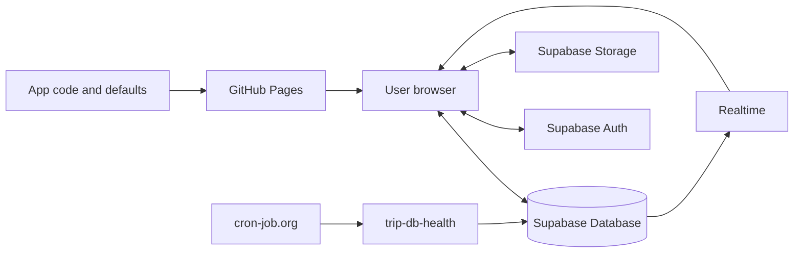

# Project Guide

For readers familiar with basic HTML who are learning JavaScript, SQL, and Supabase. The current US West app writes `schemaVersion 6` (KRW/USD); older saved documents normalize in memory without automatic public saves. New trips use `schemaVersion 7` to bind configurable currency pairs. [Usage](USER_GUIDE.md) and [operations](OPERATIONS.md) are maintained separately.

## Contents

- [Architecture](#architecture)
- [Files and runtime](#files)
- [Startup and cache](#cache)
- [State and rendering](#state)
- [Saving, conflicts, and drafts](#saving)
- [Ledger and timetable](#ledger-timetable)
- [Photos and maps](#media)
- [Offline files and imports](#offline)
- [Supabase and SQL basics](#sql-basics)
- [Server schema and permissions](#schema)
- [Public data and backup](#security-backup)
- [Glossary](#glossary)
- [References](#references)

<a id="architecture"></a>

## Architecture

Think of the app as a shared electronic travel noticeboard.

| Technology | Analogy | Responsibility |
|---|---|---|
| GitHub repository | Blueprint archive | HTML, configuration, SQL, documentation |
| GitHub Pages | Noticeboard installer | Publishes static HTML/CSS/JavaScript |
| `index.html` | Frame, buttons, mechanisms | UI and browser behavior |
| `trip-config.js` | Trip information cards | Title, dates, zones, defaults, connection settings |
| Supabase Database | Current and previous notebooks | Current document and latest 50 versions |
| Supabase Auth | Editor access check | Account/password authentication |
| Supabase Storage | Photo archive | Compressed images and thumbnails |
| Supabase Realtime | Change announcement | Notifies browsers of new saves |
| SQL | Construction instructions | Tables, functions, permissions, policies, bucket |
| IndexedDB | Visitor's large local copy | Public cache and unsaved drafts per trip |
| localStorage | Small sticky note | Last activity and theme preferences |

HTML alone displays the interface; Supabase provides shared current data and controlled editing.



Pages serves files; browser JavaScript renders and manages data; Supabase handles persistence, login, and authorization. Git history and trip versions are independent: restoring either does not restore the other.

<a id="files"></a>

## Files and runtime

- `index.html`: generated standalone HTML/CSS/dialogs and `tripAppV4`; edit the source modules below. An immediately invoked function limits variable collisions.
- `trip-config.js`: generated from `src/trip/config.js` (settings) and `src/trip/days.js` (initial itinerary). `days` generates date tabs and itinerary.
- `trip-config.template.js`: [new-trip starting point](OPERATIONS.md#new-trip).
- `supabase_setup.sql`, `register_trip.sql`: shared schema and trip registration; they do not run when visiting the app.
- `assets/`: Pages images and the bundled UI font. User uploads belong to Storage.
- `test.html`, `test2.html`: iframe previews using `index.html?previewDate=...` during/after travel; ordinary URLs use current time.
- `manifest.webmanifest`, `pwa.js`, `sw.js`, `icons/`: installation and static caching.
- `supabase/functions/trip-db-health/`: separately deployed [health function](OPERATIONS.md#db-health).
- `scripts/check-trip-sql.mjs`, `tests/fixtures/trip-sql-*.sql`: isolated PostgreSQL execution of saves, permissions, concurrency, and upgrades; see [coverage](OPERATIONS.md#validation).
- `scripts/browser-diagnostics.mjs`, `scripts/browser-fixtures.mjs`: shared diagnostics and synthetic browser fixtures.
- `.gitattributes`: LF normalization. `.git/` is version-control metadata and must not be edited directly.
- Local `reference.html` and `.agents/skills/`: design references, not deployment requirements.

`tripId`, `schemaVersion`, and `cacheNamespace` also populate HTML identity attributes. `data-offline` distinguishes online originals from working copies. Online `offlineEmbeddedState` is JSON `null`; export embeds actual state.

<a id="source-modules"></a>

### Editable source map

| Source | Responsibility |
|---|---|
| `src/index.html` | Document, dialogs, static templates and ordered includes |
| `src/theme.js` | First-paint theme and theme controls |
| `src/styles.css`, `src/styles/*.css` | Ordered cascade layers; `palette.css` owns reusable light/dark color roles |
| `src/app.js` | Ordered feature includes in one existing IIFE |
| `src/app/config.js`, `runtime.js` | Configuration validation/scaffold, constants and shared state |
| `src/app/currency.js`, `ledger*.js`, `categories.js` | Currency policy, exact money arithmetic, ledger display/editing |
| `src/app/timetable.js`, `trip-clock.js`, `navigation.js`, `schedule-editor.js` | Trip times, views and navigation |
| `src/app/state*.js`, `drafts.js`, `saving.js`, `auth-dialogs.js` | Normalization, recovery, persistence and authorization |
| `src/app/checklist-schedule.js`, `photos.js`, `exports.js`, `versions.js` | Checklist/row behavior, media, standalone files and history |
| `src/app/startup.js`, `utilities.js`, `ui-helpers.js` | Wiring and small shared helpers |
| `src/trip/config.js`, `src/trip/days.js` | Current trip settings and default itinerary |

These are source fragments with explicit include order, not independently loaded ES modules. Functions retain the existing shared closure to avoid a broad state-management rewrite. `scripts/build-app.mjs` expands root-relative `@include` lines under `src/`, normalizes LF and writes committed `index.html`/`trip-config.js`. It rejects path escapes and cycles; `--check` rejects stale outputs without rewriting them. No runtime requests, bundler dependencies or new PWA assets are introduced. Exports remain self-contained. Search/edit `src/`; inspect generated output only for deployment/debugging.

### Typography

The existing app uses self-hosted [Pretendard](https://github.com/orioncactus/pretendard) Variable 1.3.9 (`assets/PretendardVariable-1.3.9.woff2`, 2,057,688 bytes), licensed under [SIL OFL 1.1](../assets/OFL-Pretendard.txt). `--font-ui` supplies the shared family and system fallbacks; controls inherit it, and the time editor uses tabular digits. Preload and `font-display:swap` keep text visible while loading. Icons and colors are independent of the font.

Worker v3 precaches the font as a static asset. Editable/read-only HTML exports embed the font as a data URL and remove its relative preload; re-exporting embedded copies needs no font request. If the font cannot be fetched within eight seconds, export keeps the content and uses the system fallback. Canceling export still cancels the download. Daylight and historical UI previews retain their existing typography.

<a id="color-palette"></a>

### Color palette

The current site's navy/coral palette is the approved baseline (2026-10-25). Proposals A/B/C remain unselected historical previews. `src/styles/palette.css` is the source of truth for UI color roles. The build embeds its `PALETTE START` / `PALETTE END` block inside `@layer theme` in `index.html`; editable/read-only HTML exports include it automatically, with no extra stylesheet fetch or PWA asset.

| Role | Tokens | Use |
|---|---|---|
| Canvas and surfaces | `--canvas`, `--paper`, `--surface`, `--surface-alt`, `--surface-hover`, `--surface-selected` | Page, cards, groups and selection |
| Text and borders | `--ink`, `--heading-ink`, `--muted`, `--placeholder`, `--line`, `--line-strong` | Reading hierarchy and boundaries |
| Actions | `--accent`, `--accent-hover`, `--on-accent`, `--solid`, `--on-solid`, `--focus` | Coral actions, navy controls and keyboard focus |
| Timeline markers | `--timeline-accent`, `--timeline-accent-hover` | Schedule dots and legacy coral treatments |
| Header | `--header-*`, `--canvas-glow-*` | Composed navy header, clocks, progress and page glow |
| Ledger amount pairs | `--ledger-base`, `--ledger-quote` | Base amount followed by the teal quote amount in parentheses; expense rows and category totals |
| Ledger totals | `--total-*` | Navy KRW and teal USD cards |
| Status and links | `--red`, `--danger-*`, `--on-danger`, `--warning-*`, `--link-*`, `--link`, `--edit-bg`, `--overlay` | Errors, warnings, navigation and editing feedback |
| Timetable categories | `--activity-*`, `--food-*`, `--transit-*`, `--stay-*`, `--other-*` | Each category's line, background and text |

Light defaults are followed by screen-only dark overrides in the same block. Print/share uses light colors. Header and total-card colors deliberately stay composed in both themes; do not invert them automatically. Legacy `--cream`, `--navy` and `--blue` names alias `--canvas`, `--heading-ink` and `--timeline-accent`; use the role names for new code. `--accent` and `--timeline-accent` intentionally differ: readable action red versus brighter timeline coral.

Change role values in `src/styles/palette.css` rather than adding a competing root block, a production palette JSON, or per-component theme overrides. Historical component layers still contain fallback/one-off literals; their overridden values are not the current core palette. New reusable colors belong in this block; preserve one-off photographic overlays unless their treatment is in scope. Platform chrome (`theme-color`, its bootstrap values, manifest and icons) has separate startup/install requirements; update those explicitly only when that branding changes.

Theme choice remains a per-browser brightness preference, excluded from trip documents, drafts and versions. No palette selector or data migration is introduced. [Operations](OPERATIONS.md#palette-maintenance) owns change/review steps; [the dated record](archive/2026-10-25-current-palette.md) owns verification evidence.

<a id="cache"></a>

## Startup and cache

`hydrate()` builds defaults, applies the shared document for the same `tripId`, writes the IndexedDB public cache, subscribes to Realtime, and checks authentication. Failed reads use public cache, then configuration defaults.

`selectInitialTab()` uses the device's `VISITOR_TIME_ZONE` date and stops overriding navigation after user selection. Clocks refresh every minute; progress every hour.

IndexedDB holds public state, per-tab drafts, staged photos, baseline state/revision. localStorage holds small preferences such as last activity and deployment-specific theme. Theme is excluded from trip documents/versions. Browser storage is neither shared between devices nor permanent backup.

The PWA fetches static UI/configuration network-first with cache fallback on failure or after four seconds. Shared reads have an independent eight-second timeout. The service worker excludes Supabase Auth, database, and photo Storage traffic. Installation does not cache all photos.

Realtime delivers notifications. Editing, drafts, previews, and checklist saves can defer applying remote content. Lost notifications do not undo successful database writes.

<a id="state"></a>

## State and rendering

### Navigation and theme

One `.bottom-nav` outside `main` selects existing day radios without duplicating itinerary DOM. `lastScheduleDay` remembers only this run's itinerary date and does not override initial-screen logic. `timetableActive` preserves view choice; PREP/ledger hide the timetable, dates, and view controls. Clock/shared-state refreshes do not reset navigation. `applyStatePreservingInputs` retains unadded expense input.

The final `refinement` CSS layer defines fixed navigation/safe-area spacing, ledger controls, and theme menu. The same `.bottom-nav` becomes a 176px left sidebar at screen widths of 1024px or more; body padding reserves its space. Smaller screens keep bottom navigation. Print and read-only exports reserve no navigation space. Expense entry uses two columns at 1100px or below and one at 480px or below, retaining navy/coral and theme tokens.

Independent `tripThemeBootstrap` synchronizes `aria-expanded`, native radios, and effective-brightness icon. Selection/Esc restores button focus; outside click/focusin does not steal it. Storage-failure messages remain outside the menu. Theme is not part of state/drafts/versions.

### Daylight metadata compatibility

Further Daylight development/rollout is paused. Preserve `daylight/`, the candidate branch, and historical reviews; this branch's root remains the existing app.

Schema 6 uses `data-check-important="true"` on PREP labels (omitted means false) and `data-stay-checkout="YYYY-MM-DD"` on original `.timeline-row` elements. The latter identifies accommodation and checkout. Start comes from the panel's configured date; real dates/trip bounds are validated. Stay selection uses a half-open interval excluding checkout.

`checklistItems`, `patchChecklist`, and `checklistShape` carry importance through checkbox saves and list merges. Importance-only changes count as list conflicts/version differences. `sanitizeMarkup` removes invalid elements/values; `buildDiff` describes importance and checkout changes. The existing app has no dedicated controls for these attributes. See [candidate history](archive/2026-10-23-daylight-implementation.md) for Daylight-only views/settings.

Unpatched old apps may erase metadata. Parallel-use compatibility updates five functions: `checklistItems`, `checklistShape`, `patchChecklist`, `stateSummary`, `buildDiff`, preserving existing UI. Import/restore comparisons show both attributes. Reopen old windows to load the patch.

`daylight/` is generated from the preserved candidate's `index.html`, never from the current legacy root. It shares tripId, Supabase, editor, and photo bucket, but adds `_daylight` to cacheNamespace. Draft/theme/public cache are separate; default same-origin Supabase authentication is shared. Copied PWA/icons/default photos isolate worker scope and installation identity under `/daylight/`. That parallel-app generation introduced no schema/RPC/permission changes. See [operations](OPERATIONS.md#daylight-live) and the schema-6 write restrictions below.

### Stored object

Supabase stores a complete state object as JSON, rather than HTML alone:

```json
{
  "schemaVersion": 6,
  "html": "<section class=\"day prepday\">...</section>",
  "expenses": [{
    "id": "expense-example", "name": "Airport taxi",
    "amountKrw": 50750, "amountUsd": 35,
    "amountSource": "usd", "appliedExchangeRate": 1450,
    "date": "2027-01-25", "categoryId": "transport"
  }],
  "categories": [{ "id": "flight", "name": "Flights", "icon": "✈️" }],
  "exchangeRate": 1450,
  "exchangeRateUpdated": "2026-08-20",
  "budgetKrw": 0,
  "checks": [true, false, true]
}
```

Itinerary/checklist markup is already complex DOM. Saving `<main>` as a string preserves flexible cards, text, dates, and photos with less implementation work than separate tables, but requires `schemaVersion`/`normalizeState()` compatibility when markup changes. Ledger arrays make arithmetic and category aggregation reliable. The separate `checks` array preserves live checkbox properties that `innerHTML` alone may miss.

View-mode checks call `requireEditor('checklist')`; canceled authentication restores the original checkbox. Authenticated saves patch stable IDs onto the latest document using revision checks, excluding other drafts. Offline checks remain local. [Usage](USER_GUIDE.md) is authoritative.

<a id="currency-binding"></a>

### Currency binding for new trips

`ledger.currencies = { base: "KRW", quote: "JPY" }` selects two distinct ISO currency codes. `defaultExchangeRate` is base units per **one** quote unit. `src/app/currency.js` supplies symbols, Korean labels and ISO minor-unit precision; `ledger.js` uses that precision for exact conversions, validation and totals. Inputs, settings, CSV, diffs and both HTML exports use the same policy.

Schema 6 remains KRW/USD with its existing state shape and draft keys. New trips use schema 7 and store `currencyCodes: {base, quote}` in every snapshot, draft, version and offline file. Historical field names `amountKrw`/`amountUsd`, source values `krw`/`usd`, and DOM IDs remain storage slots for base/quote, not instructions to reinterpret old money. An unstamped pre-7 document means KRW/USD only; missing schema-7 codes or a mismatched pair stops reads/writes before applying data. Use a fresh trip ID/cache for a new pair. No conversion of existing production data or new SQL is required; the existing RPC schema-downgrade guard protects schema-7 trips from old clients.

`budgetKrw` is still unused compatibility metadata. Existing Daylight remains unchanged and is not a supported client for schema-7 trips.

### State functions and import protection

`captureState()` clones `<main>`, removes editing-only tools, empties generated ledger lists/summaries, and collects HTML, expenses, categories, rates, budget, and checks.

`applyState()` restores HTML/data, redecorates dates/checklists/rows, recalculates ledger output, applies checks, and restores editability for the current mode.

`normalizeState()` fills missing defaults and converts old representations. Imports pass through `sanitizeMarkup()` to strip executable scripts, iframes, event handlers, and disallowed URLs. Image `src`/`data-full-url` are validated and `srcset` removed. Missing/duplicate event/check/photo IDs are repaired before comparison, preserving unique IDs and using deterministic generated IDs so comparison/apply identify the same items.

<a id="saving"></a>

## Saving, conflicts, and drafts

`requireEditor()` checks the session; Supabase Auth verifies passwords. Server UUID mapping/RLS makes the final authorization decision. `persistState()` saves full itinerary/ledger state; `commitChecklistPatch()` applies only stable-ID checklist changes to the latest document. Both use revision-checked RPC:

```javascript
client.rpc('save_trip_document', {
  p_trip_id: TRIP_ID,
  p_content: normalizedState,
  p_expected_revision: baseRevision,
  p_version_note: note
})
```

Baseline state/revision must describe the same moment, including recovered drafts. Legacy drafts without a baseline do not adopt a newer revision merely because checklist saving succeeded; remote changes require conflict review.

After photo preparation, document saving has a 12-second timeout followed by a latest-document read to verify uncertain results. [Photo limits](#media) are independent; 12 seconds is not the whole operation limit. Unverified saves retain the draft without automatic retry. Exceptions clear busy state. Applying a successful save preserves the next expense input/focus.

`refreshPublishedState()` and Realtime also use `applyStatePreservingInputs()`: retain unadded name, raw KRW/USD strings, provenance, date/category, focus/selection; deleted categories retain the new available fallback. This protects inputs during rendering but does not persist unadded values to documents/IndexedDB.

Dismissed recovery sets a deferred draft. New editing requires recovery or explicit deletion; background writes do not overwrite it. Per-tab drafts and Web Locks protect other tabs. Without Web Locks, another page's draft is not automatically claimed.

Text input updates dirty state and starts draft persistence immediately; only undo snapshots wait for the 400ms debounce. Lifecycle/sign-out boundaries compare current content with the saved baseline. Once storage ownership/recovery is initialized, `writeDraftRecord()` synchronously checkpoints the record in localStorage before awaiting IndexedDB. Matching checkpoints are removed after commit; recovery claims abandoned checkpoints with the same Web Locks as IndexedDB drafts, preferring the newer record. The page retains its ownership lock through storage failures/retries. Active or duplicated tabs cannot claim another live page's draft. Failed initialization or storage quota/denial can still prevent persistence; navigation protection and the storage warning remain necessary.

`openDraftDatabase()` does not cache failures, allowing retry. `writeDraftRecord()` waits for transaction completion and retains the newest in-memory draft on failure. Same-tab recovery prefers memory; reload can recover a checkpoint even when the IndexedDB write was interrupted. `clearDraftRecord()` clears memory/deferred flags only after verified IndexedDB deletion and checkpoint removal; generation checks protect newer writes. Explicit discard/latest-state switching first requires successful deletion. Storage warnings are excluded from exports. Shared saving can succeed independently; failed IndexedDB writes cannot complete offline saving. See [validation](OPERATIONS.md#validation).

Deferred drafts may have `pendingDraft=false` because they are not applied. `queueCheck()`/`saveChecklistEditor()` also check `deferredDraftRecovery` before cleanup to retain the record/baseline.

`handleExternalSignOut()` saves the draft, defers recovery, and restores the last saved state, including under duplicate notifications. After reauthentication, `runPurpose()` runs recovery before itinerary/ledger/settings/import/save entry; dismissing recovery cancels that action.

Versions load metadata first, content on demand. Preview preserves the original draft before entry; autosave/pagehide/refresh during preview retain original work. Editing/normal saves are blocked. Restore confirms publication and creates a new version. Undo holds up to 100 in-memory states; the server retains 50 versions.

Idle warning occurs at 29 minutes; at 30, `scheduleSessionTimers()` or expiry in `getEditorSession()` calls `logoutPreservingDraft()`, reusing external-sign-out preservation. `recoverOnlineDraft()` checks authentication/expiry before prompting; signed-out refresh shows public state until reauthentication. Explicit Discard and sign out still deletes. `scope: 'local'` applies manual/automatic sign-out to this browser session and synchronizes its tabs.

<a id="ledger-timetable"></a>

## Ledger and timetable

`amountKrw`/`amountUsd` are fixed amounts. For the current trip, `amountSource=krw` calculates only USD; `usd` calculates only KRW; `both` means manual. In schema 7 these slots mean base/quote respectively (see [currency binding](#currency-binding)). Automatic pairs store the positive calculation rate in `appliedExchangeRate`; manual pairs store null. Old `amount`/`currency` are not written. Lists, totals, CSV, and comparisons use new fields.

`decimalParts`/`roundRatio` use BigInt rational arithmetic and positive half-up rounding. They check safe currency minor units (KRW integers/USD cents in the current trip) and JSON Number round-trip precision. New input validation is separate from legacy reading: original decimal precision survives; only the opposite currency rounds to its minor unit. Corrupt new amounts throw errors instead of becoming zero or being recomputed at today's rate.

Each schema-5-or-earlier document, draft baseline, or version converts using its own `exchangeRate`; invalid rates use the configured default with a notice. Normalized schema 6 never reconverts. Reads do not save publicly; baselines normalize consistently. Original JSON is backed up once to localStorage `<tripId>_ledger_v5_backup`; failure is reported and old server versions remain unchanged.

`expenseInput`/`expenseEditInput` keep manual raw strings separate from calculated results. Editor `original`/`touched` preserves amounts/rates for name-only changes. Comparing the original snapshot with latest entries prevents stale overwrite. Authentication waiting prevents duplicate Add; validation/calculation reruns immediately before insertion.

`assertSupportedSchema` rejects future formats before normalization. Compatibility errors reading shared documents/drafts set `documentWriteBlock`, blocking shared/PREP saves and draft write/delete. Daylight remains schema 5 and blocks writing schema-6 shared data with a refresh notice. RPC locks the document/checks revision before rejecting lower-schema writes. Follow [deployment order](OPERATIONS.md#ledger-schema-6).

The expense array holds ID, name, both amounts, source/rate, date/category; its order is display order. Both currencies total stored values. Category deletion moves entries to `deleted`. CSV includes unsaved data/current array order and escapes formula-like prefixes.

`budgetKrw`/`defaultBudgetKrw` remain compatibility-only fields; UI neither uses nor changes them. Schema 6 expands document JSON without new tables. HTML normalization replaces old ledger markup with current `moneyTemplateHtml`, preventing removed budgets/filters from returning after loading documents/drafts/versions/files. Filter variables/events/render paths are removed while expenses, budget values, importance/stay metadata, and order remain.

Timetable is a read-only projection. Start-only events have no inferred end; explicit intervals scale by duration, overlaps use columns, overnight spans continue. Unspecified/all-day/other-zone events are separate. Manual categories override keywords and survive state/version/offline round trips. See [usage](USER_GUIDE.md).

<a id="media"></a>

## Photos and maps

Attached photos use Storage; repository accommodation/map assets use Pages. Browser compression avoids transferring multi-megabyte phone originals to every viewer:

1. Select an event's photos; reject originals above 20MB each.
2. Decode and resize to at most 1600px on the long edge; verify WebP output or fall back to JPEG with white behind transparency.
3. Create at most 480px thumbnails likewise; reject compressed files above 5MB.
4. SHA-256 hash the compressed bytes; stage data URLs in IndexedDB.
5. Final confirmed Save uploads to hash paths, then replaces only successful staged items with Storage paths/public URLs in a new document version.

Discarding before upload leaves no server objects. Upload UI provides progress/cancel; public data stays unchanged until save succeeds. Failed/canceled uploads can leave already uploaded objects; retry reuses hashes.

`withPhotoRequest()` limits HEAD existence checks to 10 seconds and uploads/export downloads to 60 seconds, including response bodies, per request rather than whole batches. `operationController` cancels pending/parallel work. Timeout/cancel/network errors are not absence. HEAD 400/404 proceeds to upload, accommodating [Storage's missing-object 400 behavior](https://github.com/supabase/storage/issues/323); actual permission/path errors surface in upload responses. Failure clears busy state and retains UI/IndexedDB photo drafts.

The pinned SDK's upload does not pass cancellation, so authenticated session/public-key requests directly POST to the same Storage endpoint, retaining MIME, one-year cache, `x-upsert: false`, and INSERT policy. Authentication waiting counts toward timeout; late authentication after cancellation sends nothing. No automatic retry.

There is no fixed photo-count limit; more photos consume more Storage, export size, and memory.

```text
us-west-2027/photos/<compressed-image-hash>.webp
us-west-2027/thumbs/<compressed-image-hash>.webp
```

JPEG uses `.jpg`/`image/jpeg`. Old PNG drafts convert to supported formats on save; WebP/JPEG drafts avoid needless recompression. Identical compressed bytes share hashes/URLs; existence checks reduce duplicate upload. Changed bytes create new URLs. New uploads request one-year caching. Thumbnails load lazily; full images load on viewer entry.

Removing a photo deletes its document reference, not its Storage object, because retained versions may use it. Manual cleanup must confirm absence from current state and every retained version.

Maps store only place name and HTTPS URL; external navigation needs internet. Static accommodation photos/map captures are WebP in `assets/`, deployed with HTML without Storage upload. Map captures are non-clickable location aids; separate Google Maps links provide directions. Capture filenames are hashed; `assets/airbnb.webp` is fixed. Follow [cache updates](OPERATIONS.md#deployment) for changes.

<a id="offline"></a>

## Offline files and imports

Offline working copies embed configuration, state JSON, and photos, remove Supabase, and set `data-offline="true"`. Existing local cache is applied. Saving downloads a new working copy.

Print/share exports remove editing/server code, tools/dialogs, navigation/date/theme/CSV controls, disable inputs, and show all panels with a photo-viewing runtime. Photos embed when possible; remaining photos/maps need internet. Theme is light. Editable exports retain theme functionality/deployment path without the author's choice.

Imports validate trip ID, offline marker, supported positive-integer file/data versions, and nonempty HTML; legacy data without a version uses the file version. Sanitized differences cover itinerary, PREP, ledger, categories, and rates against latest public state. Recheck immediately before apply; changed revisions require recomparison. Application creates only a draft; final save converts/uploads photos and publishes.

`migratePublishedState()` preserves old content/checks/IDs and supplies stable legacy IDs when absent. Invalid files are rejected before changing current UI/drafts.

<a id="sql-basics"></a>

## Supabase and SQL basics

Supabase is the managed backend; no separate Node/Python/PHP application server serves the UI.

| Component | Role |
|---|---|
| Database | PostgreSQL stores current/history rows; document content is `jsonb` |
| Auth | Accounts, passwords, sessions; passwords stay outside HTML |
| Storage | WebP/JPEG files in buckets; documents retain paths |
| Realtime | Database change events delivered to browsers |
| API / `@supabase/supabase-js` | Web calls exposed as JavaScript methods |
| Edge Functions | Separately deployed server code; `trip-db-health` checks a token and reads the health row |

SQL defines, queries, and changes stored data/rules. For example:

```sql
create table example (
  id bigint primary key,
  name text not null
);
```

A database resembles a workbook, a table a sheet, a row a record, and a column a property, with stricter types, relationships, authorization, and concurrency.

Common types: `text` strings; `uuid` unique account identifiers; `bigint` large integers; `jsonb` structured JSON; `timestamptz` timezone-aware timestamps. A primary key uniquely identifies a row (`trip_documents.trip_id`); a foreign key links a row elsewhere (versions to documents).

Functions combine database operations; `save_trip_document()` atomically authorizes, adds history, replaces current content, and prunes to 50 versions. Triggers run on events, such as setting `updated_at` before update. RLS (Row Level Security) checks per-row access; policies specify allowed access. UI button visibility cannot secure direct API calls.

Current policies permit public latest-document reads, editor-only history/uploads, and no direct current-document writes. `auth.uid()` supplies the authenticated UUID; private `trip_editors` maps it to a trip. Email alone grants nothing. RPC invokes database functions by name/arguments. `security definer` runs with the function owner's privileges, so the function must recheck caller UUID; ordinary direct UPDATE is revoked.

<a id="schema"></a>

## Server schema and permissions

[supabase_setup.sql](../supabase_setup.sql) defines shared structure; [register_trip.sql](../register_trip.sql) registers trips. Follow [setup order](OPERATIONS.md#setup). SQL Editor Run executes against that remote PostgreSQL project; it does not run local HTML or redeploy Pages.

Create the configured editor email under Authentication Users before registration. Registration resolves its UUID from `auth.users`; missing accounts raise an error without creating a trip.

### Current document and editors

| `public.trip_documents` column | Meaning |
|---|---|
| `trip_id` | Primary key; current trip `us-west-2027` |
| `content` | Complete state JSON |
| `revision` | Increasing concurrency token |
| `updated_at` | Last save timestamp |

There is one current row per trip. Private `public.trip_editors` maps trip ID to Auth UUID; ordinary visitors cannot query it, and public documents do not expose the editor UUID. `set_trip_document_updated_at()` runs before update to use server `now()`.

Registration follows setup. An existing trip ID preserves content and editor mapping and stops with a message; ownership changes require explicit administrative SQL.

Current-document RLS permits `SELECT` to `anon`/`authenticated` with `using (true)`; direct authenticated UPDATE is withheld. All saving goes through the controlled RPC.

### Versions

| `public.trip_document_versions` column | Meaning |
|---|---|
| `id` | Generated version ID |
| `trip_id` | Parent trip |
| `content` | Full saved JSON |
| `note` | Save note, at most 120 characters |
| `content_size` | Serialized UTF-8 byte size |
| `created_by` | Saving user's UUID |
| `created_at` | Save time |

An index speeds newest-first lookup. Anonymous privileges are revoked; authenticated reads still require an RLS editor match. Public viewers see current content but not history.

### Save function

`save_trip_document(p_trip_id, p_content, p_expected_revision, p_version_note)`:

1. Checks the caller in `trip_editors`.
2. Validates JSON shape and the 4 MiB limit.
3. Locks the trip row and reads revision.
4. Rejects a mismatching expected revision.
5. Inserts state/note/size into history.
6. Replaces current content and increments revision.
7. Keeps the newest 50 versions.
8. Returns new version ID, revision, and timestamp as JSON.

Only `authenticated` receives execution; `public`/`anon` are revoked. The schema downgrade guard described above also applies.

### Photo bucket and policies

`trip-media` is public, permits at most 5MB per stored file, and allows `image/webp`/`image/jpeg`. Selected originals may be 20MB because upload uses compressed output. See [JPEG migration](OPERATIONS.md#updates).

Known public URLs are readable; absence of an anonymous listing policy prevents bucket enumeration. INSERT requires authentication, bucket `trip-media`, a first path component matching a registered trip, and the caller's editor mapping for that trip. Thus `us-west-2027/photos/...` is writable only by that trip's editor. Policies are shared across trips. UPDATE/DELETE are absent; new hashes preserve old photo references.

### Realtime and SQL reruns

Setup creates `supabase_realtime` publication if absent and adds `trip_documents` if needed, enabling UPDATE subscriptions.

Scripts largely support reruns through `if not exists`, `create or replace`, policy replacement, conflict handling, and publication checks. Normal reruns do not reset current itineraries but may change functions, permissions, and bucket configuration. Missing accounts, insufficient privileges, or changed service structure can still fail; inspect results.

Pushing SQL only updates a repository text file. No automatic SQL deployment exists; apply through SQL Editor or a separately configured CLI workflow.

<a id="security-backup"></a>

## Public data and backup

Project URL, publishable key, and editor email in `trip-config.js` are public browser configuration. The key is not a password; authentication, RLS, Storage policies, and function grants enforce access: anonymous current-read only, no direct update, authenticated RPC plus UUID checks, editor-only versions/uploads.

Never put editor passwords, secret/service-role keys, database passwords, or private API keys in HTML/configuration, Git, or public chat. Service-role keys can bypass RLS. Public email does not confer editing rights; the authenticated UUID must match private `trip_editors`.

Current itinerary/photo URLs are public. Keep passport numbers, full booking references, private phone numbers, and payment data out of them. Git backs up code/docs; Supabase retains only the latest 50 trip versions. Photos remain in Storage. Export photo-inclusive offline copies for portable milestone backups. Browser cache is not permanent backup.

<a id="glossary"></a>

## Glossary

| Term | Meaning |
|---|---|
| HTML / CSS / JavaScript | Page structure / appearance and layout / browser behavior |
| DOM / `contenteditable` | Browser object tree / direct-editing attribute |
| JSON / schema | Object/array exchange format / structure rules |
| Database / PostgreSQL / SQL | Structured data store / Supabase database engine / database language |
| Table / row / column | Record collection / one record / one property |
| Primary key / foreign key | Unique row identifier / link to another row |
| `jsonb` / UUID | PostgreSQL JSON type / unique identifier |
| Function / trigger / RPC | Stored operation / event-driven operation / remote function call |
| Auth / session / authorization | Login service / retained login / permission decision |
| RLS / policy | Per-row database access enforcement / its concrete rule |
| `anon` / `authenticated` | Signed-out / signed-in Supabase roles |
| Storage / bucket | File service / file collection |
| Realtime / publication | Change delivery / PostgreSQL change-export configuration |
| API / CDN | Program request interface / distributed file-delivery network |
| Cache / IndexedDB / localStorage | Temporary copy / asynchronous structured browser storage / small string storage |
| WebP / hash / Base64 | Compressed image format / content digest / binary-to-text encoding |
| Git / commit / push | File history / saved change set / upload commits to a remote |
| GitHub Pages / static site | GitHub file hosting / site serving prepared files |
| Supabase / backend / frontend | Managed backend / persistence and access services / browser UI and code |

<a id="references"></a>

## References

This guide describes repository code. Consult official documentation for service details:

- [Supabase architecture](https://supabase.com/docs/guides/getting-started/architecture)
- [Database](https://supabase.com/docs/guides/database/overview)
- [Auth](https://supabase.com/docs/guides/auth) and [Auth architecture](https://supabase.com/docs/guides/auth/architecture)
- [Row Level Security](https://supabase.com/docs/guides/database/postgres/row-level-security)
- [Data security and public keys](https://supabase.com/docs/guides/database/secure-data)
- [Storage access control](https://supabase.com/docs/guides/storage/security/access-control)
- [Realtime](https://supabase.com/docs/guides/realtime/getting_started)
- [About GitHub Pages](https://docs.github.com/en/pages/getting-started-with-github-pages/what-is-github-pages)
- [GitHub Pages getting started](https://docs.github.com/en/pages/getting-started-with-github-pages)
