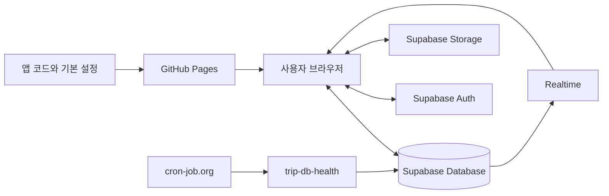

# 프로젝트 기술 설명서

기본 HTML을 알고 JavaScript·SQL·Supabase를 배우는 독자를 위한 동작 설명서입니다. 현재 저장 형식은 `schemaVersion 5`입니다.
버튼 사용법은 [사용자 안내서](USER_GUIDE_KO.md), 설정·검증·배포는 [운영 안내서](OPERATIONS_KO.md)에서 관리합니다.

## 목차

- [전체 구조](#architecture)
- [파일과 실행 구조](#files)
- [초기화와 캐시](#cache)
- [저장 데이터와 화면 변환](#state)
- [저장·충돌·초안 보호](#saving)
- [가계부와 시간표](#ledger-timetable)
- [사진과 지도](#media)
- [오프라인 파일과 가져오기](#offline)
- [Supabase와 SQL 기초](#sql-basics)
- [서버 스키마와 권한](#schema)
- [공개 범위와 백업](#security-backup)
- [용어 사전](#glossary)
- [참고 문서](#references)

<a id="architecture"></a>

## 전체 구조

이 프로젝트를 여러 사람이 보는 전자 여행 안내판이라고 생각해 보자.

| 실제 기술 | 쉬운 비유 | 이 프로젝트에서 하는 일 |
|---|---|---|
| GitHub 저장소 | 안내판 설계도 보관함 | `index.html`, `trip-config.js`, SQL 설정문, 설명서를 보관한다. |
| GitHub Pages | 안내판을 설치해 주는 업체 | 저장소의 HTML/CSS/JavaScript를 공개 웹주소에 배포한다. |
| `index.html` | 안내판의 틀, 버튼, 화면, 작동 장치 | 일정 UI와 모든 브라우저 동작을 담고 있다. |
| `trip-config.js` | 여행별 내용 카드 | 제목, 기간, 시간대, 기본 일정과 연결 정보를 담고 있다. |
| Supabase Database | 최신 여행 노트와 과거 노트 보관함 | 현재 일정과 최근 50개 저장 버전을 보관한다. |
| Supabase Auth | 편집실 출입 확인 | 올바른 이메일 계정과 비밀번호인지 확인한다. |
| Supabase Storage | 사진 창고 | 압축된 일정 사진과 미리보기를 보관한다. |
| Supabase Realtime | “새 안내문이 나왔습니다” 알림 방송 | 다른 브라우저에 새 저장본이 생겼다고 알린다. |
| SQL | 창고와 출입 규칙을 만드는 공사 지시서 | 표, 함수, 권한, 정책, 사진 버킷을 한 번에 설정한다. |
| 브라우저 `IndexedDB` | 각 관람객 주머니의 큰 임시 복사본 | 서버 연결 실패에 대비한 최근 공개본과 저장하지 않은 초안을 여행별로 저장한다. |
| 브라우저 `localStorage` | 작은 메모지 | 마지막 활동 시각과 테마 선택 같은 작은 값을 저장한다. |

이 비유에서 `index.html`만 있으면 안내판의 모양은 보이지만, 여러 사람이 같은 최신 내용을 보고 편집 권한을 통제하려면 Supabase가 필요하다.



GitHub Pages는 정적 파일을 전달하고 브라우저의 JavaScript가 화면과 데이터를 처리합니다. Supabase는 서버 저장·로그인·권한을 담당합니다. Git 변경 이력과 Supabase의 여행 버전은 독립적이며 한쪽을 복원해도 다른 쪽은 바뀌지 않습니다.

<a id="files"></a>

## 파일과 실행 구조

- `index.html`: HTML·CSS·대화상자·`tripAppV4` 스크립트를 포함한 공통 앱. 즉시 실행 함수로 내부 변수의 충돌을 줄입니다.
- `trip-config.js`: 제목, 기간, 시간대, PREP, 가계부 기본값, 날짜별 일정, Supabase 연결 정보. `days`에 맞춰 탭과 일정을 생성합니다.
- `trip-config.template.js`: 다른 여행 설정의 시작점. 식별값·예시는 [재사용 절차](OPERATIONS_KO.md#new-trip)에 있습니다.
- `supabase_setup.sql`과 `register_trip.sql`: 공통 서버 구조와 여행 등록을 분리합니다. 방문할 때 실행되지 않습니다.
- `assets/`: GitHub Pages에 배포하는 숙소·지도 이미지. 앱에서 업로드한 사진은 Supabase Storage에 있습니다.
- `test.html`, `test2.html`: `index.html?previewDate=...`를 iframe으로 열어 진행 중·종료 후 상태를 확인합니다. 일반 주소는 실제 현재 시간을 사용합니다.
- `manifest.webmanifest`, `pwa.js`, `sw.js`, `icons/`: 설치 정보·서비스 워커·정적 캐시.
- `supabase/functions/trip-db-health/`: 별도 배포하는 점검 함수. [운영 설명](OPERATIONS_KO.md#db-health)을 참고합니다.
- `.gitattributes`: LF 줄바꿈 통일. `.git/`은 직접 수정하지 않는 버전 관리 메타데이터입니다.
- 로컬 `reference.html`·`.agents/skills/`는 디자인 참고 자료이며 배포 필수 파일이 아닙니다.

`tripId`, `schemaVersion`, `cacheNamespace`는 HTML의 여행·스키마·저장소 식별 속성에도 반영됩니다. `data-offline`은 온라인 원본과 오프라인 작업본을 구분합니다. 온라인의 `offlineEmbeddedState` JSON은 `null`이고 내보낼 때 실제 상태를 담습니다.

<a id="cache"></a>

## 초기화와 캐시

`hydrate()`는 기본 화면을 만든 뒤 같은 `tripId`의 공유본을 읽어 적용하고 IndexedDB 공개 캐시에 보관합니다. Realtime을 구독하고 로그인 세션을 확인합니다. 서버 조회에 실패하면 최근 공개 캐시, 그것도 없으면 설정 파일의 기본 내용을 사용합니다.

목적지 시간대의 날짜로 최초 탭을 정하며 사용자가 선택한 뒤에는 자동 선택이 개입하지 않습니다. 두 시계는 1분마다, 여행 진행률은 한 시간마다 갱신합니다.

IndexedDB는 공개본·탭별 초안·사진 스테이징과 기준 상태/revision을 저장합니다. localStorage는 마지막 활동 시각과 배포 경로별 테마 선택 등 작은 설정을 보관합니다. 테마는 여행 데이터·공유 저장·버전에 포함하지 않습니다. 브라우저 저장소는 기기 간 공유나 영구 백업이 아닙니다.

PWA는 정적 화면·설정 파일을 네트워크 우선으로 갱신하고 네트워크 실패 또는 4초 제한 시 캐시를 사용합니다. 공유본 조회는 별도로 8초 제한을 적용합니다. 서비스 워커는 Supabase 인증·DB API·사진 Storage 요청을 캐시하지 않습니다. 설치만으로 모든 여행 사진이 저장되지는 않습니다.

Realtime은 변경 알림입니다. 편집·초안·미리보기·체크리스트 저장 중에는 작업을 보호하기 위해 최신 화면을 바로 적용하지 않을 수 있습니다. 알림이 끊겨도 성공적으로 저장된 DB 내용은 유지됩니다.

<a id="state"></a>

## 저장 데이터와 화면 변환

Supabase에는 단순 HTML만 저장하지 않는다. 전체 상태를 나타내는 JavaScript 객체를 JSON으로 바꾸어 저장한다.

개념적으로는 다음과 같다.

```json
{
  "schemaVersion": 5,
  "html": "<section class=\"day prepday\">...</section>",
  "expenses": [
    {
      "id": "expense-예시",
      "name": "공항 택시",
      "amount": 35,
      "currency": "USD",
      "date": "2027-01-25",
      "categoryId": "transport"
    }
  ],
  "categories": [
    { "id": "flight", "name": "항공", "icon": "✈️" }
  ],
  "exchangeRate": 1450,
  "exchangeRateUpdated": "2026-08-20",
  "budgetKrw": 0,
  "checks": [true, false, true]
}
```

### 왜 일정은 `html` 문자열로 저장하는가

일정과 체크리스트는 이미 화면에 복잡한 HTML 구조로 존재한다. 각 문장, 카드, 날짜 제목, 사진 요소를 모두 별도의 데이터 표로 나누는 대신 `<main>` 내부 HTML을 한 덩어리 문자열로 저장하면 현재 화면 구조를 비교적 간단하게 복원할 수 있다.

장점은 구현이 간단하고 자유로운 편집 구조를 그대로 보존한다는 것이다. 단점은 HTML 구조가 바뀌면 과거 데이터와의 호환성을 신경 써야 한다는 것이다. 그래서 `schemaVersion`과 `normalizeState()`가 존재한다.

### 왜 가계부는 별도 배열인가

가계부는 합계, 통화 변환, 카테고리별 집계를 계산해야 한다. HTML 글자만 저장하는 것보다 금액, 통화, 날짜, 카테고리를 각각 속성으로 보관해야 계산하기 쉽다.

### 왜 체크 여부는 `checks` 배열인가

체크박스의 현재 체크 상태는 브라우저 DOM의 `checked` 속성으로 바뀐다. 이 값은 단순히 `innerHTML`을 읽는 것만으로 항상 정확하게 보존되지 않는다. 따라서 각 체크박스의 참/거짓 상태를 별도 배열로 저장한다.

보기 모드에서 체크하거나 해제하면 `requireEditor('checklist')`가 편집자 세션을 확인한다. 인증을 취소하면 원래 체크 상태를 유지한다. 인증 후에는 안정적인 항목 ID로 최신 공유본에 변경을 적용하고 revision을 확인해 즉시 저장한다. 다른 일정·가계부 초안은 함께 저장하지 않는다. 오프라인에서는 브라우저에 보관한다. 최신 사용 절차는 [사용자 안내서](USER_GUIDE_KO.md)를 기준으로 한다.

### `captureState()`

현재 화면을 저장 가능한 상태 객체로 만드는 함수다.

주요 작업은 다음과 같다.

- `<main>`을 복사한다.
- 편집 중에만 필요한 삭제 버튼과 도구를 복사본에서 제거한다.
- 렌더링 결과로 만들어진 가계부 목록과 요약을 비운다.
- HTML, 가계부 배열, 카테고리, 환율, 예산, 체크 상태를 한 객체로 모은다.

즉, “현재 보이는 화면을 저장용 상자에 담기”다.

### `applyState()`

저장된 상태를 실제 화면에 되돌리는 함수다.

- 저장된 HTML을 `<main>`에 넣는다.
- 가계부와 카테고리 변수를 복원한다.
- 날짜, 체크리스트, 일정 행을 다시 꾸민다.
- 가계부를 다시 계산해 그린다.
- 체크박스 참/거짓 값을 적용한다.
- 현재 편집 모드인지에 맞춰 편집 가능 여부를 다시 설정한다.

즉, “저장 상자의 내용을 화면에 풀기”다.

### `normalizeState()`와 가져오기 보안

`normalizeState()`는 데이터가 누락되거나 과거 형식이어도 기본값을 채우고 현재 앱이 이해할 수 있는 형태로 정리한다.

외부 HTML 작업본을 가져올 때는 `sanitizeMarkup()` 계열 처리를 통해 위험한 태그나 속성을 제거한다. 예를 들어 실행 스크립트, iframe, `onclick` 같은 이벤트 속성, 허용하지 않은 주소 형식을 걸러 낸다. 이는 가져온 HTML에 악성 JavaScript가 숨어 실행되는 위험을 줄이기 위한 방어다.

<a id="saving"></a>

## 저장·충돌·초안 보호

`requireEditor()`는 편집자 세션을 확인하며 비밀번호 인증은 Supabase Auth가 수행합니다. 최종 쓰기 권한은 서버의 편집자 UUID 검사와 RLS가 결정합니다.

`persistState()`는 일정·가계부 전체 상태를 저장합니다. PREP는 `commitChecklistPatch()`가 안정적인 항목 ID를 기준으로 최신 공유본에 해당 변경만 적용합니다. 다른 초안을 함께 공개하지 않습니다. 두 경로 모두 revision을 확인하는 RPC를 호출합니다.

```javascript
client.rpc('save_trip_document', {
  p_trip_id: TRIP_ID,
  p_content: normalizedState,
  p_expected_revision: baseRevision,
  p_version_note: note
})
```

기준 상태와 revision은 같은 시점을 가리켜야 합니다. 복구한 초안도 두 값을 함께 유지하고, 기준 상태가 없는 구형 초안은 체크 저장 성공만으로 최신 revision을 채택하지 않습니다. 서버가 먼저 바뀌면 충돌을 확인합니다.

사진 준비가 끝난 뒤 공유 문서 저장 요청에 12초 제한을 두고 시간 초과 후 최신 공유본을 조회하여 반영 여부를 확인합니다. 사진 통신에는 [별도 요청 제한](#media)을 적용하므로 전체 작업의 제한 시간이 12초라는 뜻은 아닙니다. 확인되지 않으면 초안을 유지하고 자동 재저장은 하지 않습니다. 예외에서도 저장 중 상태를 해제하고, 저장 응답 후 화면을 적용할 때 다음 가계부 항목의 입력과 초점을 보존합니다.

공유본 재조회(`refreshPublishedState()`)와 Realtime 갱신도 `applyStatePreservingInputs()`로 화면을 반영합니다. 아직 추가하지 않은 가계부 항목명·금액·날짜·통화·카테고리와 초점·선택 범위를 복원하며, 삭제된 카테고리는 새 선택 목록의 기본값을 유지합니다. 입력 보존은 화면 갱신에만 적용되며, 추가 전 입력을 공유 데이터나 IndexedDB 초안으로 저장하지 않습니다.

초안 복구 안내를 닫으면 기존 초안을 보류합니다. 새 편집 전에 다시 복구 또는 명시적 삭제를 선택하며, 백그라운드 저장도 보류한 초안을 덮어쓰지 않습니다. 탭별 초안과 Web Locks로 다른 열린 탭의 작업을 보호합니다. Web Locks 미지원 환경에서는 다른 페이지의 초안을 자동으로 가져오지 않습니다.

보류한 초안은 화면에 적용되지 않아 `pendingDraft`가 거짓일 수 있습니다. PREP의 체크 완료(`queueCheck()`)와 목록 저장(`saveChecklistEditor()`)은 초안 정리 전에 `deferredDraftRecovery`도 확인해 보류된 기록과 복구 기준을 보존합니다.

외부 로그아웃(`handleExternalSignOut()`)도 미저장 초안을 기록한 뒤 `deferredDraftRecovery`를 설정하고 마지막 저장본으로 돌아갑니다. 중복 로그아웃 알림에도 보류 상태를 유지합니다. 재인증 후 `runPurpose()`가 일정·가계부·가계부 설정·불러오기·저장 진입 전에 기존 복구 절차를 실행하며, 복구 안내를 닫으면 해당 작업을 취소합니다.

버전 목록은 메타데이터만 읽고 선택한 버전의 본문을 지연 로딩합니다. 미리보기 진입 전에 원래 초안을 보존하며 미리보기 중 자동 저장·페이지 숨김·새로고침도 원래 작업을 저장합니다. 미리보기 중 편집과 일반 저장은 차단하고 과거 내용 공개는 복원 확인을 거칩니다. 복원은 과거 내용을 새 버전으로 저장합니다.

실행 취소는 메모리에 최대 100개 상태를 보관하고 서버 버전은 최근 50개를 유지합니다. 자동 로그아웃은 마지막 활동 후 29분에 경고하고 30분에 미저장 초안을 폐기합니다. 수동·자동 로그아웃은 `scope: 'local'`로 현재 브라우저 세션에 적용하며 같은 브라우저 탭에 동기화합니다.

<a id="ledger-timetable"></a>

## 가계부와 시간표

가계부는 `expenses` 배열에 ID·항목명·금액·통화·날짜·카테고리 ID를 보관하고 배열 순서가 표시 순서입니다. 수동 환율로 원화 합계를 계산하고 카테고리 삭제 시 연결된 항목은 `deleted`로 옮깁니다. CSV는 현재 필터 결과를 내보내며 수식으로 오인할 수 있는 접두 문자를 이스케이프합니다.

시간표는 현재 불러온 일정의 보기용 표현입니다. 시작만 있는 일정은 종료를 추정하지 않고, 명시적 시간 구간은 길이에 비례해 표시합니다. 겹침은 나란히 배치하고 자정을 넘는 구간은 다음 날로 이어집니다. 시간 미정·종일·다른 시간대는 별도로 표시합니다. 수동 분류가 자동 키워드 분류보다 우선하며 여행 상태·버전·오프라인 작업본에 유지됩니다. 구체적인 조작은 [사용자 안내서](USER_GUIDE_KO.md)를 참고하세요.

<a id="media"></a>

## 사진과 지도

사진은 크게 두 종류다. 편집 화면에서 새로 첨부하는 사진은 Supabase Storage에 저장되고, 저장소의 `assets/`에 포함된 숙소 사진과 지도 캡처는 GitHub Pages의 정적 파일로 배포된다.

### 사진을 바로 원본으로 올리지 않는 이유

휴대전화 사진은 한 장이 수 MB에서 수십 MB가 될 수 있다. 모든 방문자가 큰 원본을 받으면 데이터 사용량과 로딩 시간이 커진다. 그래서 브라우저에서 먼저 압축한다.

현재 흐름은 다음과 같다.

1. 일정 행에서 사진 추가를 선택한다.
2. 선택한 각 원본 파일이 20MB를 넘는지 확인한다.
3. 브라우저에서 이미지를 해석한다.
4. 큰 보기용 이미지를 최대 변 1600px로 만든다. WebP 출력 결과를 확인하고, 미지원 브라우저에서는 JPEG로 다시 변환한다. JPEG의 투명한 부분은 흰 배경으로 처리한다.
5. 목록용 썸네일을 최대 변 480px로 같은 방식으로 만든다. 압축 후에도 5MB를 넘으면 사진 크기를 줄이도록 안내한다.
6. 압축된 파일 내용의 SHA-256 해시를 계산한다.
7. 압축 결과를 data URL 초안으로 IndexedDB에 스테이징한다.
8. 사용자가 최종 `저장`을 확인하면 해시 경로로 Supabase Storage에 업로드한다.
9. 업로드가 끝난 사진만 Storage 경로와 공개 URL로 바꿔 새 문서 버전에 기록한다.

최종 저장을 시작하기 전에 사진 초안을 폐기하면 서버에 객체를 남기지 않는다. 업로드 중에는 진행률과 취소 UI를 제공하며, 저장이 성공하기 전까지 공개 문서는 바뀌지 않는다. 업로드 도중 실패·취소하면 이미 서버가 받은 객체는 남을 수 있으며, 재시도는 같은 해시 경로를 재사용한다.

`withPhotoRequest()`는 사진 존재 확인(HEAD)에 10초, 업로드와 내보내기용 다운로드에 각각 60초 제한을 적용한다. 응답 본문 읽기까지 포함한 요청별 제한이며 전체 사진 묶음의 제한은 아니다. `operationController`가 취소 신호를 전달하고 작업 종료 시 남은 병렬 요청도 중단한다. 제한 시간·취소·네트워크 오류를 객체 미존재로 취급하지 않는다. HEAD의 400·404는 업로드 확인 단계로 진행한다. 이는 [Storage가 미존재 객체에 400을 반환하는 호환 동작](https://github.com/supabase/storage/issues/323)을 처리하기 위함이며, 실제 권한·경로 오류는 업로드 응답에서 확인한다. 실패·취소 후 저장 중 상태를 해제하고 화면과 IndexedDB의 사진 초안을 보존한다.

현재 고정 SDK의 Storage `upload()`는 취소 신호를 전달하지 않아, SDK에서 얻은 로그인 세션과 공개 키로 Storage의 동일한 객체 POST 주소를 직접 호출한다. MIME·1년 캐시·`x-upsert: false`와 기존 INSERT 정책을 유지한다. 인증을 기다리는 시간도 업로드 제한에 포함하며, 취소 후 늦게 인증 응답이 와도 전송하지 않는다. 자동 재시도는 하지 않는다.

사진 개수에는 앱 차원의 고정 제한을 두지 않았지만, 사진이 많을수록 Storage 용량, 오프라인 내보내기 파일 크기, 브라우저 메모리 사용량이 늘어난다.

### 해시 기반 파일명과 캐시

개념적인 저장 경로는 다음과 같다.

```text
us-west-2027/photos/<압축 이미지의 해시>.webp
us-west-2027/thumbs/<압축 이미지의 해시>.webp
```

JPEG로 변환된 사진은 `.jpg` 확장자와 `image/jpeg` MIME을 사용한다. 기존 PNG 초안은 저장할 때 지원 형식으로 다시 변환한다. WebP와 JPEG 초안은 불필요한 재압축 없이 저장한다.

내용이 완전히 같은 압축 이미지는 같은 해시를 만든다. 업로드 전에 같은 경로가 이미 있는지 확인하므로 중복 업로드를 줄일 수 있다.

또한 파일 내용이 바뀌면 해시와 URL도 바뀌고, 바뀌지 않으면 URL도 그대로다. 새 업로드는 1년의 캐시 기간을 지정하므로 브라우저가 같은 URL의 사진을 다시 내려받지 않을 수 있다. “사진이 바뀌었을 때만 새 파일을 받는다”는 목적에 적합한 구조다.

### 썸네일 지연 로딩

일정 화면에서는 작은 썸네일을 사용하고 지연 로딩을 적용한다. 큰 이미지는 사용자가 사진을 눌러 뷰어를 열 때만 요청한다. 이것도 데이터 사용량을 줄인다.

### 화면에서 사진을 삭제할 때

사진 삭제는 일정 문서에서 그 사진에 대한 참조를 제거한다. Storage의 실제 파일은 즉시 삭제하지 않는다.

이유는 과거 50개 버전이 그 사진을 여전히 참조할 수 있기 때문이다. 실제 Storage 파일을 지워 버리면 과거 버전을 미리보거나 복원했을 때 사진이 깨진다.

단점은 시간이 지나면 사용하지 않는 파일이 쌓일 수 있다는 것이다. 수동 정리를 할 때는 현재 저장본과 보관된 50개 버전 어디에서도 참조하지 않는 파일인지 확인해야 한다.

### 지도

Google Maps 연결 기능은 지도 데이터 자체를 저장하지 않는다. 일정마다 다음만 기록한다.

- 장소명
- `https://`로 시작하는 외부 지도 링크

사용자가 `Google Maps · 장소명` 링크를 열면 Google Maps 등 외부 서비스로 이동한다. 따라서 외부 지도 열기에는 인터넷이 필요하다.

### 저장소에 포함된 정적 사진과 지도 캡처

확정된 숙소의 외관과 주변 지도 캡처는 `assets/` 아래의 WebP 파일로 들어 있다. 이 이미지는 `index.html`과 함께 GitHub Pages에서 배포되며 Supabase Storage 업로드 절차를 거치지 않는다.

지도 캡처는 위치를 빠르게 확인하기 위한 비클릭 이미지이고, 실제 길 찾기는 별도의 Google Maps 링크를 사용한다. 지도 캡처 파일명에는 내용 해시가 포함되지만 `assets/airbnb.webp`는 고정 경로다. 정적 이미지 변경 시에는 [캐시 갱신 절차](OPERATIONS_KO.md#deployment)도 따른다.

<a id="offline"></a>

## 오프라인 파일과 가져오기

오프라인 작업본은 현재 설정과 전체 상태 JSON, 사진을 HTML 안에 담고 Supabase 연결을 제거합니다. `data-offline="true"`로 구분하며 로컬 캐시가 있으면 적용합니다. 편집 후 저장은 서버 전송 대신 새 작업본 다운로드로 이어집니다.

인쇄·공유용 사본은 편집·서버 연결 코드와 도구·대화상자를 제거하고 입력을 비활성화한 스냅샷입니다. 읽기 전용 탭 전환 런타임은 유지합니다. 가능한 사진을 내장하며 실패한 사진과 지도 링크는 인터넷 연결이 필요합니다. 테마는 밝게 고정됩니다. 편집 가능한 작업본은 테마 기능과 배포 경로를 유지하되 작성자의 테마 선택을 복사하지 않습니다.

가져오기는 여행 ID, 오프라인 표시, 스키마 호환성, 데이터 유무를 검사하고 HTML을 정제합니다. 최신 공유본과 일정·PREP·가계부·카테고리·환율 등의 차이를 비교하고 적용 직전 공유본이 바뀌면 다시 비교합니다. 적용 결과는 초안이며 공유 저장 시에만 사진을 지원 형식(WebP/JPEG)으로 업로드하고 서버에 반영합니다.

<a id="sql-basics"></a>

## Supabase와 SQL 기초

Supabase는 웹앱이 자주 필요로 하는 서버 기능을 한 프로젝트 안에서 제공하는 관리형 서비스다. 이 프로젝트에서는 다음 기능을 사용한다.

### Database

PostgreSQL이라는 관계형 데이터베이스다. 현재 문서와 버전 기록을 표 형태로 저장한다. 일정 내용 자체는 `jsonb`라는 JSON 저장 형식을 사용한다.

### Auth

사용자 계정과 비밀번호 로그인을 처리한다. 편집자 비밀번호를 HTML에 넣지 않고 Supabase가 검증한다.

### Storage

사진 같은 파일을 저장한다. 데이터베이스에는 사진 경로를 저장하고 실제 WebP 또는 JPEG 파일은 Storage 버킷에 둔다.

### Realtime

데이터베이스 행이 바뀌었을 때 연결된 브라우저에 변경 이벤트를 전달한다. 누군가 저장하면 다른 사람이 새로고침하지 않아도 새 저장본을 받을 수 있게 한다.

### API와 JavaScript 클라이언트

Supabase는 데이터베이스와 Auth/Storage 기능을 웹에서 호출할 수 있는 API를 자동 제공한다. `@supabase/supabase-js` 라이브러리는 이 API를 JavaScript 함수처럼 사용하게 해 준다.

웹앱 화면을 제공하기 위해 별도 Node.js, Python, PHP 서버를 운영하지 않는다. 서버 역할의 상당 부분을 외부 Supabase 프로젝트가 담당한다.

### Edge Functions

Supabase에서 실행하는 서버 함수다. 이 저장소의 `trip-db-health`가 호출 토큰을 확인하고 DB 점검 행을 조회한다. GitHub Pages에서 실행되는 코드와 배포 경로가 다르며, 함수 소스는 Supabase에 별도로 배포한다.

### SQL이란

SQL은 데이터베이스에 구조를 만들거나 데이터를 읽고 변경하도록 지시하는 언어다. HTML이 화면 구조를 표현한다면 SQL은 데이터 보관함의 구조와 규칙을 표현한다고 생각하면 된다.

예를 들어 다음 SQL은 `example`이라는 표를 만든다는 뜻이다.

```sql
create table example (
  id bigint primary key,
  name text not null
);
```

### 데이터베이스, 표, 행, 열

엑셀에 비유하면 이해하기 쉽다.

| 데이터베이스 용어 | 엑셀 비유 | 예시 |
|---|---|---|
| Database | 통합 문서 | 이 Supabase 프로젝트의 PostgreSQL |
| Table | 시트 | `trip_documents` |
| Row | 한 줄 | `us-west-2027` 여행 한 건 |
| Column | 열 | `trip_id`, `content`, `updated_at` |

다만 데이터베이스는 엑셀보다 자료형, 관계, 권한, 동시 접근 규칙이 엄격하다.

### 자주 나오는 자료형

- `text`: 글자
- `uuid`: 매우 긴 고유 식별자. 편집자 계정 ID에 사용한다.
- `bigint`: 큰 정수. 버전 번호에 사용한다.
- `jsonb`: JSON 구조를 데이터베이스가 다루기 좋은 형태로 저장한다.
- `timestamptz`: 시간대 정보를 고려한 날짜와 시각이다.

### 기본 키와 외래 키

- `primary key`: 표에서 각 행을 유일하게 찾는 값이다. `trip_documents.trip_id`가 해당한다.
- `foreign key`: 다른 표의 행과 연결하는 값이다. 버전 표의 `trip_id`는 최신 문서 표의 `trip_id`를 참조한다.

### 함수

데이터베이스 안에 저장해 두는 작은 프로그램이다. 이 프로젝트의 `save_trip_document()` 함수는 권한 검사, 버전 추가, 최신본 교체, 50개 정리를 한 번의 안전한 작업으로 묶는다.

### 트리거

특정 사건이 생기면 자동으로 실행되는 장치다. 최신 문서가 수정되기 직전에 `updated_at`을 현재 시각으로 바꾸는 트리거가 있다.

### RLS와 정책

RLS는 Row Level Security의 약자로, “어떤 사용자가 어떤 행을 읽거나 바꿀 수 있는가”를 데이터베이스가 직접 검사하는 기능이다.

정책은 RLS의 구체적인 규칙이다.

- 최신 여행 문서: 누구나 읽기 가능
- 버전 기록: 지정 편집자만 읽기 가능
- 사진 업로드: 지정 편집자만 가능
- 최신 문서 직접 수정: 허용하지 않고 저장 함수만 사용

브라우저 UI에서 버튼을 숨기는 것만으로는 보안이 되지 않는다. 사용자가 개발자 도구나 직접 API 호출을 사용할 수도 있기 때문이다. RLS와 데이터베이스 함수가 서버 쪽에서 최종 권한을 검사해야 한다.

### `auth.uid()`

현재 Supabase에 로그인한 사용자의 고유 UUID를 돌려주는 값이다. SQL은 이 UUID가 비공개 `trip_editors` 권한표에서 해당 여행과 연결되어 있는지 비교한다. 이메일 문자열만 믿고 저장하는 것이 아니다.

### RPC

Remote Procedure Call의 약자다. 브라우저에서 데이터베이스 함수를 이름과 인수로 호출하는 것이다. 이 프로젝트에서는 `save_trip_document`를 호출한다.

### `security definer`

데이터베이스 함수가 그 함수를 만든 사람의 권한으로 필요한 작업을 수행하도록 하는 설정이다. 강력할 수 있기 때문에 함수 안에서 반드시 호출자를 다시 확인해야 한다.

현재 함수는 `auth.uid()`가 `trip_editors`에서 이 여행의 편집자로 등록되어 있는지 검사한 뒤에만 버전 추가와 문서 갱신을 수행한다. 또한 일반 사용자의 직접 `UPDATE` 권한은 취소되어 있다. 즉, 강한 권한을 아무 데나 열지 않고 검증된 저장 통로 하나에 집중한 구조다.

<a id="schema"></a>

## 서버 스키마와 권한

아래는 [supabase_setup.sql](../supabase_setup.sql)과 [register_trip.sql](../register_trip.sql)의 역할입니다. 실행 순서는 [초기 구축](OPERATIONS_KO.md#setup)에서 관리합니다.

Supabase SQL Editor에서 이 파일을 붙여 넣고 `Run`을 눌렀다는 것은, 아래 명령들을 **인터넷에 있는 해당 Supabase 프로젝트의 PostgreSQL 데이터베이스에서 실행했다**는 뜻이다.

로컬 PC에서 HTML을 실행한 것도 아니고, GitHub Pages를 다시 배포한 것도 아니다.

### 사전 조건: 편집자 계정

`supabase_setup.sql`은 공통 표와 권한을 만든다. 여행을 실제로 등록하기 전에는 Authentication의 Users에서 `trip-config.js`에 적은 편집자 이메일 계정을 만들어야 한다.

이후 `register_trip.sql`이 `auth.users`에서 해당 이메일의 UUID를 찾아 여행 행과 연결한다. 계정이 없다면 원인을 바로 알 수 있도록 오류를 표시하고 여행 행을 만들지 않는다.

### 최신 문서 표 생성

`public.trip_documents` 표를 만든다.

| 열 | 의미 |
|---|---|
| `trip_id` | 여행 고유 이름. 현재는 `us-west-2027` |
| `content` | 일정 전체 상태 JSON |
| `revision` | 동시 저장 충돌을 감지하는 증가 번호 |
| `updated_at` | 마지막 저장 시각 |

`trip_id`가 기본 키이므로 같은 여행 ID의 최신 문서는 한 행만 존재한다.

### 비공개 편집자 권한표

`public.trip_editors`는 `trip_id`와 편집자 Auth UUID를 연결한다. 공개 `trip_documents` 행에서는 편집자 UUID를 제거했기 때문에 익명 조회 결과로 계정 식별자가 노출되지 않는다. 일반 방문자에게는 이 표의 조회 권한도 없다.

### 수정 시각 트리거 생성

`set_trip_document_updated_at()` 함수를 만들고 `trip_documents`가 업데이트되기 직전에 자동 실행하도록 트리거를 연결한다.

JavaScript가 시간을 직접 보내지 않아도 데이터베이스 서버 시각으로 `updated_at = now()`가 된다.

### 여행 행 등록

`supabase_setup.sql` 실행 후 `register_trip.sql`을 별도로 실행한다. 이 파일은 Auth 사용자 중 설정한 이메일의 UUID를 찾아 설정한 `trip_id` 행을 만든다.

같은 여행 ID가 이미 있으면 일정 `content`와 기존 편집자 연결을 모두 유지하고 중단한다. `register_trip.sql`은 실수로 기존 여행의 소유자를 바꾸지 않으며, 결과 메시지로 기존 연결을 확인하라고 안내한다. 편집자 변경은 별도의 명시적인 관리 SQL로 처리해야 한다.

### 최신 문서 RLS와 읽기 권한

RLS를 켜고 `anon`, `authenticated` 역할 모두에게 `SELECT`를 허용한다. 그리고 `using (true)` 정책으로 모든 사람이 최신 여행 행을 읽을 수 있게 한다.

이것이 로그인하지 않은 사람도 공개 여행 페이지를 볼 수 있는 서버 쪽 근거다.

반면 인증 사용자에게 직접 `UPDATE` 권한은 주지 않는다. 저장은 뒤에서 만드는 통제된 함수만 사용한다.

### 버전 표 생성

`public.trip_document_versions` 표를 만든다.

| 열 | 의미 |
|---|---|
| `id` | 자동 증가하는 버전 ID |
| `trip_id` | 어느 여행의 버전인지 |
| `content` | 그때 저장한 전체 상태 JSON |
| `note` | 저장 시 입력한 120자 이내 메모 |
| `content_size` | 상태 JSON의 UTF-8 바이트 크기 |
| `created_by` | 저장한 Auth 사용자 UUID |
| `created_at` | 저장 시각 |

최신순 버전 조회가 빨라지도록 인덱스도 만든다.

### 버전 표 보안

- 익명 사용자에게는 모든 권한을 취소한다.
- 로그인 사용자에게 조회 권한을 주되 RLS 정책으로 다시 제한한다.
- 현재 사용자의 `auth.uid()`가 `trip_editors`에서 해당 여행의 편집자로 등록되어 있을 때만 읽을 수 있다.

따라서 공개 방문자는 현재 공개본은 볼 수 있지만 과거 버전 목록은 볼 수 없다.

### 저장 함수 생성

`save_trip_document(p_trip_id, p_content, p_expected_revision, p_version_note)`가 저장의 핵심이다.

내부 순서는 다음과 같다.

1. `trip_editors`에서 현재 사용자의 편집 권한을 확인한다.
2. 상태 JSON 구조와 4 MiB 크기 제한을 확인한다.
3. 해당 여행 행을 잠그고 서버의 현재 revision을 읽는다.
4. 브라우저가 보낸 `p_expected_revision`과 다르면 충돌 오류를 낸다.
5. 새 상태, 메모와 용량을 버전 표에 삽입한다.
6. 최신 문서의 `content`를 바꾸고 revision을 1 올린다.
7. 버전을 최신순으로 50개만 남기고 오래된 행을 삭제한다.
8. 새 버전 ID, revision과 업데이트 시각을 JSON으로 돌려준다.

함수 실행 권한은 `authenticated`에만 주고 `public`, `anon`에서는 취소한다.

### 사진 버킷 생성

Supabase Storage에 `trip-media` 버킷을 만든다.

설정은 다음과 같다.

- 공개 버킷
- 저장 파일 한 개의 최대 크기 5MB
- 허용 MIME 형식은 `image/webp`, `image/jpeg`

브라우저에서 선택 가능한 원본의 제한은 20MB지만, Storage에 실제로 올리는 것은 압축된 WebP 또는 JPEG이며 5MB 이하여야 한다.

기존 서버의 JPEG 허용 마이그레이션 절차는 [업데이트 안내](OPERATIONS_KO.md#updates)를 참고한다.

### 사진 접근 정책

공개 버킷이므로 URL을 아는 방문자는 사진을 볼 수 있다. 별도의 익명 `SELECT` 정책을 만들지 않아 버킷 전체 파일 목록을 익명으로 나열하는 것은 막는다.

업로드 `INSERT`는 다음 조건을 모두 만족해야 한다.

- 로그인한 사용자
- `trip-media` 버킷
- 파일 경로의 첫 폴더가 등록된 `trip_id`와 같음
- 사용자의 UUID가 `trip_editors`에서 해당 여행과 연결됨

예를 들어 `us-west-2027/photos/...`는 `us-west-2027` 여행 행의 편집자만 업로드할 수 있다. 새 여행도 같은 정책을 사용하므로 SQL 정책을 여행마다 복제할 필요가 없다.

`UPDATE`와 `DELETE` 정책은 만들지 않는다. 앱도 기존 사진 파일을 덮어쓰거나 삭제하지 않는다. 해시 기반 새 파일을 만들고 과거 버전의 사진 참조를 보존하기 위한 결정이다.

### Realtime 설정

`supabase_realtime` publication이 없으면 만들고, `trip_documents` 표가 포함되지 않았으면 추가한다.

publication은 PostgreSQL 변경 내용을 Realtime 시스템이 전달할 수 있도록 공개할 표의 목록에 가깝다. 이 설정 덕분에 JavaScript가 `trip_documents`의 `UPDATE` 이벤트를 구독할 수 있다.

### 같은 SQL을 다시 Run하면 어떻게 되는가

파일은 상당 부분 다시 실행할 수 있도록 작성되어 있다.

- `create table if not exists`: 표가 없을 때만 생성
- `create or replace function`: 함수를 최신 정의로 교체
- `drop policy if exists` 후 `create policy`: 정책을 다시 설정
- `on conflict ... do nothing/update`: 기존 행이나 버킷을 무작정 중복 생성하지 않음
- Realtime publication과 표 포함 여부를 검사

일반적인 재실행으로 최신 여행 내용이 초기화되도록 작성되어 있지는 않다. 하지만 권한, 함수, 버킷 설정은 SQL 내용에 맞게 다시 설정될 수 있다. 계정이 없거나 실행 권한이 부족하거나 Supabase 측 구조가 달라졌다면 오류가 날 수 있으므로 실행 결과 메시지를 확인해야 한다.

### GitHub에 SQL 파일을 push하면 자동 실행되는가

아니다. 현재 저장소에는 SQL을 자동으로 Supabase에 배포하는 CI/CD 설정이 없다.

```text
supabase_setup.sql 수정 + GitHub push
→ GitHub에 텍스트 파일이 바뀔 뿐
→ Supabase 데이터베이스 설정은 그대로
```

Supabase 설정을 실제로 바꾸려면 SQL Editor에서 새 SQL을 직접 실행하거나 별도의 Supabase CLI/자동 배포 체계를 구축해야 한다.

<a id="security-backup"></a>

## 공개 범위와 백업

`trip-config.js`에는 다음 종류의 값이 들어 있다.

- Supabase 프로젝트 URL
- Supabase publishable key
- 편집자 이메일

이 값들은 브라우저가 Supabase 프로젝트를 찾고 공개 API를 호출하기 위한 정보다. 웹페이지 소스는 방문자에게 전달되므로 이 값들은 누구나 볼 수 있다고 전제해야 한다.

### publishable key가 보여도 되는 이유

publishable key는 브라우저 같은 공개 환경에서 사용하도록 만들어진 프로젝트 식별용 키다. 이 키 자체를 비밀번호처럼 믿지 않는다. 실제 데이터 접근 가능 여부는 로그인 상태, RLS, Storage 정책, 함수 권한이 결정한다.

그래서 이 프로젝트는 다음처럼 방어한다.

- 공개 최신 일정 읽기만 익명 허용
- 직접 문서 업데이트 권한 취소
- 저장 함수는 로그인 사용자만 호출
- 함수 안에서 편집자 UUID 재검사
- 버전 목록은 편집자만 조회
- 사진 업로드도 편집자 UUID 재검사

### 절대 넣으면 안 되는 값

다음은 `index.html`, `trip-config.js`, GitHub 저장소, 공개 채팅에 넣으면 안 된다.

- 편집자 비밀번호
- Supabase secret key 또는 `service_role` 키
- 데이터베이스 직접 접속 비밀번호
- 다른 서비스의 비밀 API 키

특히 service role 계열 비밀 키는 RLS를 우회할 수 있으므로 브라우저 코드에 들어가면 매우 위험하다.

### 편집자 이메일은 보안 비밀인가

현재 이메일은 JavaScript에 있으므로 공개 정보로 취급해야 한다. 이메일 자체가 저장 권한을 주는 것은 아니다. 비밀번호 로그인 후 얻은 사용자 UUID가 비공개 `trip_editors` 권한표에 연결되어 있어야 저장할 수 있다.

### 사진과 일정의 공개 범위

이 프로젝트는 공개 여행 페이지를 목표로 하므로 최신 일정과 공개 사진 URL도 사실상 공개 정보다. 여권번호, 예약번호 전체, 개인 전화번호, 결제 정보처럼 민감한 내용은 일정이나 사진에 넣지 않는 것이 안전하다.

Git은 코드·문서를, Supabase 버전은 최근 여행 상태를 보존합니다. 사진은 Storage에 남지만 과거 버전은 50개를 넘으면 제거됩니다. 중요한 시점의 휴대 가능한 백업은 사진을 포함한 오프라인 작업본으로 만듭니다. 브라우저 캐시는 영구 백업이 아닙니다.

<a id="glossary"></a>

## 용어 사전

| 용어 | 쉬운 뜻 |
|---|---|
| HTML | 웹페이지의 내용과 구조를 표현하는 언어 |
| CSS | 웹페이지의 모양과 배치를 정하는 언어 |
| JavaScript | 브라우저에서 버튼과 데이터 처리를 실행하는 프로그래밍 언어 |
| DOM | 브라우저가 HTML을 객체 구조로 바꿔 놓은 것 |
| `contenteditable` | 일반 HTML 요소를 사용자가 직접 타이핑해 고칠 수 있게 하는 속성 |
| JSON | 객체와 배열을 글자 형식으로 표현해 주고받는 데이터 형식 |
| Schema | 저장 데이터나 표가 어떤 구조를 갖는지 정한 규칙 |
| Database | 구조화된 데이터를 저장하고 조회하는 시스템 |
| PostgreSQL | Supabase가 사용하는 관계형 데이터베이스 |
| SQL | 데이터베이스 구조와 데이터를 다루는 언어 |
| Table | 같은 종류의 데이터를 행과 열로 보관하는 표 |
| Row | 표의 데이터 한 건 |
| Column | 표의 한 속성 |
| Primary key | 행을 유일하게 구분하는 값 |
| Foreign key | 다른 표의 행을 가리키는 연결 값 |
| `jsonb` | PostgreSQL이 JSON을 효율적으로 저장하는 자료형 |
| UUID | 계정 등을 고유하게 식별하는 긴 값 |
| Function | 데이터베이스 안에 저장한 작업 절차 |
| Trigger | 특정 데이터 사건 때 자동 실행되는 장치 |
| RPC | 브라우저에서 원격 데이터베이스 함수를 호출하는 방식 |
| Auth | 사용자 가입, 로그인, 세션을 다루는 인증 기능 |
| Session | 로그인한 상태를 일정 기간 유지하는 정보 |
| Authorization | 로그인한 사용자가 무엇을 할 수 있는지 결정하는 권한 검사 |
| RLS | 데이터 행별 접근 권한을 데이터베이스가 검사하는 기능 |
| Policy | RLS에서 사용하는 구체적인 허용 규칙 |
| `anon` | 로그인하지 않은 Supabase 방문자 역할 |
| `authenticated` | 로그인한 Supabase 사용자 역할 |
| Storage | 사진 같은 파일을 보관하는 서비스 |
| Bucket | Storage 안의 큰 파일 보관 구역 |
| Realtime | 데이터 변경 이벤트를 연결된 브라우저에 전달하는 기능 |
| Publication | PostgreSQL 변경 내용을 Realtime에 내보낼 표 목록과 관련된 설정 |
| API | 서로 다른 프로그램이 정해진 방식으로 요청하고 응답하는 통로 |
| CDN | 여러 지역 서버를 통해 파일을 빠르게 전달하는 네트워크 |
| Cache | 같은 데이터를 매번 받지 않도록 임시 보관한 복사본 |
| `IndexedDB` | 브라우저가 큰 구조화 데이터와 초안을 비동기로 보관하는 공간 |
| `localStorage` | 브라우저가 작은 문자열 값을 보관하는 공간 |
| WebP | 사진 용량을 줄이는 데 유리한 이미지 형식 |
| Hash | 파일 내용으로부터 계산한 사실상 고유한 요약값 |
| Base64 | 이미지 같은 이진 데이터를 HTML 안에 넣을 수 있는 문자열로 표현하는 방식 |
| Git | 파일 변경 이력을 관리하는 도구 |
| Commit | Git에 남긴 한 묶음의 변경 기록 |
| Push | 로컬 Git 커밋을 GitHub 같은 원격 저장소에 올리는 일 |
| GitHub Pages | GitHub 저장소의 정적 웹 파일을 공개하는 호스팅 서비스 |
| Static site | 서버에서 매 요청마다 프로그램을 실행하지 않고 준비된 파일을 전달하는 웹사이트 |
| Supabase | Database, Auth, Storage, Realtime 등을 제공하는 관리형 백엔드 서비스 |
| Backend | 데이터 저장, 인증, 권한처럼 사용자 화면 뒤에서 일하는 부분 |
| Frontend | 브라우저에 보이고 사용자가 조작하는 화면과 코드 |

<a id="references"></a>

## 참고 문서

이 설명서는 현재 프로젝트 코드를 기준으로 작성했다. 서비스 자체의 최신 상세 동작은 아래 공식 문서를 함께 참고한다.

- [Supabase 아키텍처](https://supabase.com/docs/guides/getting-started/architecture)
- [Supabase Database 개요](https://supabase.com/docs/guides/database/overview)
- [Supabase Auth](https://supabase.com/docs/guides/auth)
- [Supabase Auth 아키텍처](https://supabase.com/docs/guides/auth/architecture)
- [Postgres Row Level Security](https://supabase.com/docs/guides/database/postgres/row-level-security)
- [Supabase 데이터 보안과 공개 키](https://supabase.com/docs/guides/database/secure-data)
- [Supabase Storage 접근 제어](https://supabase.com/docs/guides/storage/security/access-control)
- [Supabase Realtime 시작하기](https://supabase.com/docs/guides/realtime/getting_started)
- [GitHub Pages란 무엇인가](https://docs.github.com/en/pages/getting-started-with-github-pages/what-is-github-pages)
- [GitHub Pages 시작 안내](https://docs.github.com/en/pages/getting-started-with-github-pages)
